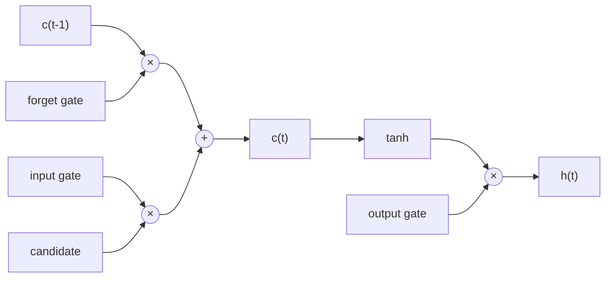
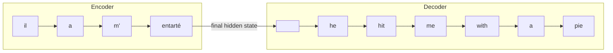

Last lecture we ended with vanilla RNNs and their vanishing gradient problem. This lecture is about the fixes, and then using them for something real, which is machine translation.

## Why do vanilla RNNs forget?

At each step, the hidden state gets multiplied by the same weight matrix and squished through an activation. After 20 or 30 steps, whatever the first word contributed has either vanished or exploded. So the model basically can't remember stuff from far back.

In a sentence like *"The cats, which were sitting on the old couch in the living room, **are** hungry"*, the model needs to remember that "cats" is plural all the way to the word "are". A vanilla RNN struggles with this.

## LSTMs (Long Short-Term Memory)

The idea is to give the network a separate **memory lane** called the **cell state** $c_t$, and let it learn when to write to it, when to erase from it, and when to read from it. These are controlled by **gates**. A gate is just a sigmoid, so it outputs values between 0 (closed) and 1 (open).

There are three gates:

1. **Forget gate** $f_t$: what should I erase from the cell state?
2. **Input gate** $i_t$: what new stuff should I write to the cell state?
3. **Output gate** $o_t$: what part of the cell state should I show as the hidden state?

$$
f_t = \sigma(W_f [h_{t-1}, x_t] + b_f)
$$
$$
i_t = \sigma(W_i [h_{t-1}, x_t] + b_i)
$$
$$
o_t = \sigma(W_o [h_{t-1}, x_t] + b_o)
$$

New candidate content:
$$
\tilde{c}_t = \tanh(W_c [h_{t-1}, x_t] + b_c)
$$

Update the cell and compute the hidden state:
$$
c_t = f_t \circ c_{t-1} + i_t \circ \tilde{c}_t
$$
$$
h_t = o_t \circ \tanh(c_t)
$$

### Why does this fix the vanishing gradient?

Look at the line $c_t = f_t \circ c_{t-1} + i_t \circ \tilde{c}_t$. The cell state is updated by **addition**, not by repeatedly multiplying with a weight matrix. If the forget gate stays close to 1, the information (and the gradient) flows through the cell state almost untouched. This gives the gradient a clean highway to travel back through time.

Note that it doesn't *guarantee* no vanishing gradients, it just makes it a lot easier for the model to learn long-term dependencies.

## GRUs (Gated Recurrent Units)

GRUs are the lighter cousin. There's no separate cell state, just the hidden state, and only two gates:

- **Update gate** $z_t$: how much of the old state to keep vs. replace
- **Reset gate** $r_t$: how much of the old state to look at when computing new content

$$
h_t = (1 - z_t) \circ h_{t-1} + z_t \circ \tilde{h}_t
$$

Fewer parameters, so faster to train. In practice, performance is pretty similar to LSTMs. A good rule: LSTM is the default, try a GRU if you want speed.

## Bidirectional and multi-layer RNNs

- **Bidirectional:** run one RNN left to right and another right to left, then concatenate the hidden states. Now each word's representation knows about both its left and right context. This is only possible if you have the whole sentence (so fine for NER, not for generating text).
- **Multi-layer (stacked):** the hidden states of layer 1 become the inputs to layer 2. Deeper layers can learn more abstract features. 2 to 4 layers is typical for RNNs.

## Machine Translation

The task: take a sentence in a source language, and output a sentence in a target language.

Before neural nets, this was done with Statistical MT (SMT), which was a huge system with a ton of hand-engineered parts. Neural MT replaced all of it with a single network.

## Seq2Seq

A seq2seq model has two RNNs:

1. **Encoder:** reads the source sentence and compresses it into a vector.
2. **Decoder:** takes that vector and generates the target sentence word by word.

The decoder is basically a **conditional language model**. It's a language model (predicting the next word), but conditioned on the source sentence.

### Training

We have pairs of sentences. At each decoder step, we compute the cross entropy loss between the predicted word and the actual word, then sum these up. We then backprop through the whole thing, decoder and encoder together, end to end.

**Teacher forcing:** during training, we feed the decoder the *actual* previous word, not what it predicted. Otherwise early mistakes would snowball and training would be unstable.

### Decoding

At test time, we don't have the actual words, so we need to pick them.

- **Greedy decoding:** pick the highest probability word at each step. Problem: if you make one wrong choice, you can't go back.
- **Beam search:** keep track of the top $k$ partial translations (the beam size) at every step. At the end, pick the one with the best overall score. $k$ is usually 5 to 10. Bigger $k$ is more expensive, and gives diminishing returns.

### The bottleneck problem

Look at the encoder again. The entire source sentence has to be squeezed into **one fixed size vector** (the final hidden state). For a 5 word sentence, this is fine. For a 50 word sentence, it's a disaster.

This is exactly the problem that attention was built to solve, and that's the next lecture.

## Evaluating MT: BLEU

BLEU compares the machine translation against one or more human translations by counting overlapping n-grams (1 to 4), and adds a penalty for being too short.

It's not perfect. A perfectly good translation worded differently from the reference will score low. But it's cheap, so everyone uses it.
