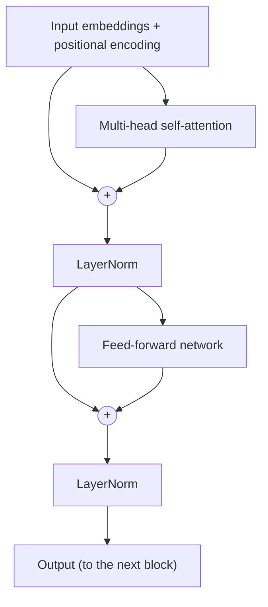

So now we know that attention is great. And we also know that RNNs have a pretty big problem that we haven't talked about yet.

## The problem with RNNs

1. **They're sequential.** To compute $h_t$, you need $h_{t-1}$ first. You can't parallelize across time steps, so training on GPUs is slow.
2. **Linear interaction distance.** For two words that are $k$ words apart, it takes $O(k)$ steps for information to travel between them. Far apart words struggle to interact.

The idea behind the Transformer: **what if we drop the recurrence completely and just use attention?**

## Self-Attention

Before, attention was between the decoder and the encoder. Now, every word attends to **every other word in the same sentence**.

Each word gets turned into three different vectors using three learned weight matrices:

- **Query** $q_i = W^Q x_i$ : what am I looking for?
- **Key** $k_i = W^K x_i$ : what do I contain?
- **Value** $v_i = W^V x_i$ : what do I actually give out if you pick me?

Think of it like a library. The query is what you walk in looking for, the key is the label on each book's spine, and the value is the content inside the book. You compare your query with all the labels, and then read more from the books whose labels match well.

For word $i$:

$$
e_{ij} = q_i^T k_j
$$
$$
\alpha_{ij} = \text{softmax}_j(e_{ij})
$$
$$
\text{output}_i = \sum_j \alpha_{ij} v_j
$$

And in matrix form, for the whole sentence at once:

$$
\text{Attention}(Q, K, V) = \text{softmax}\left(\frac{QK^T}{\sqrt{d_k}}\right) V
$$

### Why divide by $\sqrt{d_k}$?

When $d_k$ is large, the dot products get really large in magnitude, which pushes the softmax into regions where it's almost one-hot and the gradients are tiny. Dividing by $\sqrt{d_k}$ keeps things in a sensible range. This is called **scaled** dot-product attention.

### The good part

All of this is just matrix multiplication, so the whole sentence is computed **in parallel**. And any two words interact directly in one step, no matter how far apart they are.

## Fixing the problems with self-attention

Self-attention on its own has some issues. The Transformer adds a few fixes.

### 1. No notion of order

Self-attention treats the input as a **set**. "Dog bites man" and "Man bites dog" would look identical to it!

**Fix: positional encodings.** We add a vector that depends on the position to each word embedding. The original paper used sine and cosine waves of different frequencies:

$$
PE_{(pos, 2i)} = \sin(pos / 10000^{2i/d})
$$
$$
PE_{(pos, 2i+1)} = \cos(pos / 10000^{2i/d})
$$

Modern models often learn the position embeddings instead, or use relative methods like RoPE.

### 2. No non-linearity

Self-attention is basically just weighted averages. That's not much power.

**Fix: a feed-forward network** applied to each position independently, after attention. It's usually two linear layers with a ReLU or GELU in between, with the hidden layer about 4× as wide.

### 3. Looking into the future

When we're generating text, word $i$ should not see words after it (that would be cheating).

**Fix: masking.** We set the attention score to $-\infty$ for all future positions before the softmax, so they get a weight of 0.

## Multi-head attention

One attention head can only focus on one kind of relationship at a time. But a word might need to look at several things: its subject, its adjective, the previous word, and so on.

So we run **multiple attention heads in parallel**, each with its own $W^Q, W^K, W^V$, each working on a smaller dimension ($d/h$). Then we concatenate all outputs and pass through one more linear layer. The total cost stays about the same as one big head.

## The Transformer block

Two other tricks that make it trainable:

- **Residual connections:** we add the input back to the output of each sub-layer ($x + \text{Sublayer}(x)$). This gives gradients a clean path back (same logic as the LSTM cell state highway).
- **Layer normalization:** normalizes the activations at each layer so training is stable.

Stack 6 to 100+ of these blocks and you have a Transformer.

## Encoder vs Decoder

- **Encoder:** self-attention with no mask (every word sees everything).
- **Decoder:** *masked* self-attention, plus **cross-attention** to the encoder's output (this is the same encoder-decoder attention from last lecture, where queries come from the decoder, and keys and values come from the encoder).

## The catch

Self-attention compares every word to every other word, so the cost is **quadratic**: $O(n^2)$ in the sequence length. This is why long contexts get expensive, and why there's a whole sub-field working on making this cheaper.
