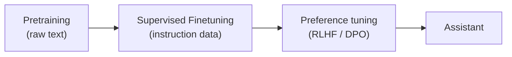

A pretrained language model is a really good *text continuer*, but it's not an *assistant*. If you ask it "How do I bake bread?", it might continue with "How do I bake cake? How do I bake cookies?", because that's what a list of questions on the internet looks like.

Post-training is how we turn that base model into something useful, and safe.

## Step 1: Instruction tuning (SFT)

We collect a dataset of **(instruction, ideal response)** pairs, written by humans. Then we just finetune the model on it with the same next token loss as before.

Some findings:
- You don't need *that much* data. A few thousand good examples can go a long way.
- **Quality matters more than quantity.**
- Training on a huge variety of tasks makes the model generalize to unseen instructions.

### The limits of SFT

- Writing good responses is expensive.
- It only teaches the model to imitate. It never learns what *not* to do.
- Humans are often better at **judging** two answers than at writing a perfect one from scratch. This is the key insight that leads us to the next step.

## Step 2: Learning from human preferences

Instead of asking humans to write answers, we ask them to **rank** them. The model produces two answers to the same prompt, and a human says which one is better.

### RLHF (Reinforcement Learning from Human Feedback)

**Part A: Train a reward model.**

We train a model $R(x, y)$ that takes a prompt $x$ and response $y$ and outputs a single number: how good it is. We train it on the preference pairs, so that the preferred answer $y_w$ gets a higher score than the rejected one $y_l$.

$$
\mathcal{L} = -\log \sigma\left(R(x, y_w) - R(x, y_l)\right)
$$

(This is the Bradley-Terry model. It just says the probability of preferring one answer over another depends on the difference of their scores.)

**Part B: Optimize the language model against the reward model with RL.**

We treat the LM as a policy, and use an algorithm like **PPO** to make it generate responses that get high reward.

But there's a catch. If we only maximize reward, the model will find weird ways to cheat the reward model (**reward hacking**), producing gibberish that scores high. So we add a **KL penalty** that keeps the model close to the original SFT model:

$$
\max_\pi \; \mathbb{E}\left[R(x, y)\right] - \beta \, D_{KL}\left(\pi \,\|\, \pi_{ref}\right)
$$

### The problem with RLHF

It's complicated and unstable. You have to juggle 4 models at once (policy, reference, reward model, value model), and PPO is notoriously hard to tune.

## DPO (Direct Preference Optimization)

DPO shows that you can **skip the reward model and the RL entirely**. With some math, the RLHF objective can be rewritten as a simple classification-style loss directly on the preference pairs:

$$
\mathcal{L}_{DPO} = -\log \sigma\left(\beta \log \frac{\pi_\theta(y_w|x)}{\pi_{ref}(y_w|x)} - \beta \log \frac{\pi_\theta(y_l|x)}{\pi_{ref}(y_l|x)}\right)
$$

In words: increase the probability of the good answer, decrease the probability of the bad one, relative to the reference model. No sampling, no reward model. Just a supervised-like training loop.

It's way simpler, and it's become really popular. People still debate whether it's as good as proper RL at the very top end.

## Some issues to keep in mind

- **Human preferences are noisy.** People disagree with each other.
- **Models can learn to flatter.** Humans tend to prefer longer and more confident-sounding answers, and models pick up on that, even when the answer is wrong.
- **Hallucination.** Post-training doesn't magically fix it, and teaching a model to say "I don't know" is still hard.
- **Safety vs helpfulness tradeoff.** Too much safety training and the model refuses harmless questions.
