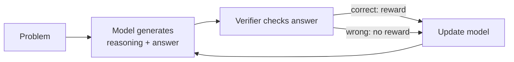
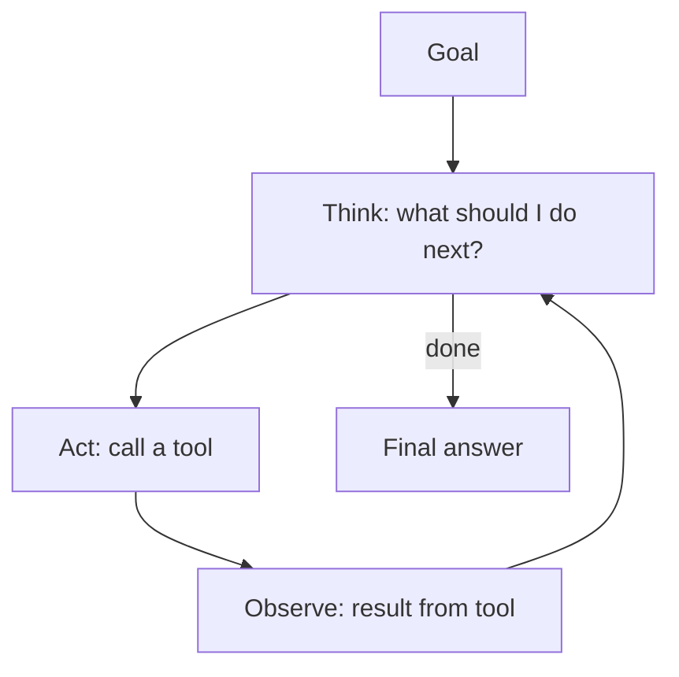

So far, our models predict the next token. That's it. But these models can now solve math problems, write code, and use tools. This lecture is about how we got from "autocomplete" to that.

## Chain-of-Thought (CoT)

The first big discovery was really simple. If you ask a model a multi-step question and ask for the answer directly, it often gets it wrong. But if you get it to **write out its steps first**, it does way better.

```
Q: Roger has 5 balls. He buys 2 cans of 3 balls each. How many balls now?

Direct answer: 11   (sometimes it just guesses)

With reasoning:
Roger starts with 5. 2 cans × 3 balls = 6 balls. 5 + 6 = 11.
The answer is 11.
```

Why does this work? A Transformer only does a fixed amount of computation per token. Writing out intermediate steps gives the model more "thinking time", and the intermediate results are written into the context where it can use them.

Even just adding "Let's think step by step" to the prompt helps (zero-shot CoT).

## Improving on plain CoT

### Self-consistency
Sample multiple reasoning paths (with some randomness), take the final answer from each, and go with the **majority vote**. If a problem has one right answer but many ways to reach it, wrong paths tend to disagree with each other, while right paths tend to agree.

### Tree / search methods
Instead of one chain, explore multiple branches of reasoning, evaluate how promising each one is, and prune the bad ones. More compute, better answers on hard problems.

## Training models to reason

Prompting only gets you so far. The newer idea is to **train** the model to reason well, using reinforcement learning.

The setup works best when we can **automatically verify** the answer:
- Math: does the final answer match the known solution?
- Code: do the unit tests pass?



No human labels the reasoning steps. The model only gets a reward for the final result, and RL pushes it towards whichever kinds of reasoning lead to correct answers. Interestingly, behaviours like double-checking, backtracking, and trying a different approach start to **emerge** on their own.

This is called **RL with verifiable rewards**, and it's what's behind the "reasoning models" that think for a long time before answering.

### Test-time compute
This gives us a new axis for scaling. Before, we scaled by making the model bigger or training on more data. Now we can also scale by letting the model **think for longer at inference time**. For hard problems, spending more tokens on reasoning gives better answers.

The tradeoff is cost and latency, since long reasoning means more tokens to generate.

## Language model agents

A normal chatbot answers once. An **agent** is an LLM that can take actions in a loop to reach a goal.

The core loop:



This is basically the **ReAct** pattern (Reason + Act): the model alternates between writing out its thoughts and calling tools, and the tool outputs get fed back into its context.

### Tools
A tool is just a function the model can call: a search engine, a calculator, a code interpreter, a database query, a browser, an API. The model writes out the call in a structured format (like JSON), the system runs it, and the result goes back into the context.

This fixes some of the weaknesses of LLMs:
- Can't do exact arithmetic → use a calculator or write code.
- Knowledge is frozen at training time → search the web.
- Can't act on the world → call APIs.

### Memory and planning
Agents working on long tasks need a way to remember what they've done, which is usually a mix of the context window and external storage they can read and write. They also often **plan** first, breaking a big goal into smaller steps.

## The challenges

- **Errors compound.** If each step is 90% reliable, then a 10 step task only succeeds about 35% of the time ($0.9^{10}$).
- **Long horizons.** Models can lose track of the goal or get stuck in loops.
- **Safety.** Letting a model take real actions (send emails, run code, spend money) means mistakes have real consequences. This needs sandboxing, permissions, and human oversight.
- **Evaluation.** It's much harder to evaluate a multi-step agent than a single answer.

## Takeaway

The trend is: models don't just generate text anymore. They think before answering (reasoning), and act in the world (agents). Both are built on the same Transformer, just trained and used in a smarter way.
