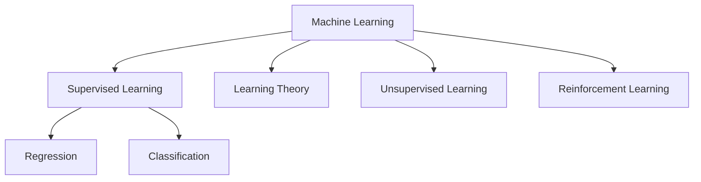

## The Course

- Broad introduction to machine learning and statistical pattern recognition.
- Four big buckets we'll go through:
    - Supervised learning
    - Learning theory
    - Unsupervised learning
    - Reinforcement learning
- Lots of math (linear algebra, probability), and lots of practical advice on actually making things work.

## What is Machine Learning?

Arthur Samuel's definition (old school): *the field of study that gives computers the ability to learn without being explicitly programmed.* He wrote a checkers program that played against itself thousands of times and ended up better than him.

Tom Mitchell's definition (more formal):

> A program is said to learn from experience **E** with respect to some task **T** and performance measure **P**, if its performance on **T**, as measured by **P**, improves with experience **E**.

For checkers: **E** is games played against itself, **T** is playing checkers, **P** is the chance of winning the next game.

## Supervised Learning

This is the most common type. You give the algorithm both the inputs **x** and the right answers **y**, and it learns the mapping $x \rightarrow y$.

Housing prices is the classic example. You have the size of the house (x) and the price (y). Fit a line, and predict the price of a new house.

```
price
  |            . 
  |         .  /
  |      . /.
  |    . /
  |  ./ .
  |_/_________ size
```

- **Regression:** the thing you predict is continuous (price).
- **Classification:** the thing you predict is discrete (tumor is malignant or benign).

And if we have more than one feature (size, age of tumor, cell shape...), then x becomes a vector, and we're drawing a decision boundary in a higher dimensional space. Some algorithms can even work with an **infinite** number of features, which is what we'll see with SVMs and kernels.

## Learning Theory

When does an algorithm work, and when doesn't it? How much data do I need? Why does it overfit? This part of the course is about understanding those things, so you can make good decisions instead of just trying things randomly.

## Unsupervised Learning

Now we only have **x**, with no labels. Find structure in the data.

- Clustering (group similar things, like market segmentation or grouping genes)
- The cocktail party problem: you have two microphones in a room with two people talking, and you want to separate the two voices. Surprisingly, this can be done with just a few lines of code (ICA, which we'll get to).

## Reinforcement Learning

There's no right answer given for each step. Instead you have a **reward function** that tells the agent if it's doing well or badly. Think of training a dog: you don't tell it exactly what to do, you just give it a treat when it does something good. An example is flying an autonomous helicopter.



## One more thing

Andrew keeps saying that having the algorithms is only half the battle. The other half is knowing how to apply them. Two people can use the same algorithm, and one will get it working in a week while the other wastes six months. A lot of this course is about being the first person.
