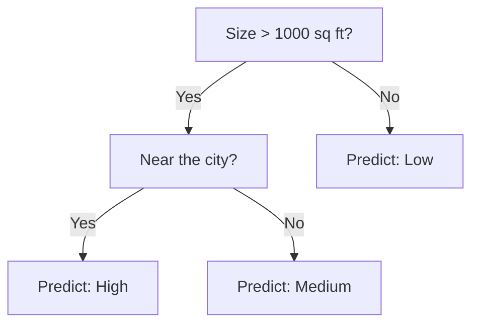

## Decision Trees

The idea is to split the input space into regions using a sequence of yes/no questions. It's the way you'd play 20 questions.

### Building a tree (greedy, top-down)

At each node, we choose the split that **best separates the classes**. Say a region $R_p$ is split into $R_1$ and $R_2$ using feature $j$ and threshold $t$:

$$
R_1 = \{x \in R_p : x_j < t\}, \quad R_2 = \{x \in R_p : x_j \geq t\}
$$

We pick $(j, t)$ that maximizes the reduction in loss:

$$
L(R_p) - \left(\frac{|R_1|}{|R_p|}L(R_1) + \frac{|R_2|}{|R_p|}L(R_2)\right)
$$

Then recurse on each child until some stopping condition.

### Which loss $L$?

You might think of misclassification error, but it's not sensitive enough. A split might improve the purity of the regions without changing the number of misclassified points, so the misclassification loss can't see it.

So we use a smoother measure. Let $\hat{p}_c$ be the fraction of points in the region that belong to class $c$.

- **Cross-entropy:** $L = -\sum_c \hat{p}_c \log \hat{p}_c$
- **Gini:** $L = \sum_c \hat{p}_c(1 - \hat{p}_c)$

Both are zero when the region is pure, and large when it's a mix.

### Regression trees

For continuous targets, each region predicts the **mean** of the $y$ values in it, and we use squared error as the loss.

### Pros and cons

**Pros**
- Easy to explain and interpret
- Handles categorical features and mixed types
- Fast to train and predict

**Cons**
- **High variance.** A small change in the data can give a completely different tree.
- Bad at additive structure (e.g., $y = x_1 + x_2$ needs a staircase of splits).
- Generally lower predictive accuracy than other methods.

If you keep splitting until each leaf is pure, you overfit. You can limit the depth, set a minimum leaf size, or prune afterwards.

## Ensembling

Since a single tree has high variance, combine many of them. Idea: if you average $M$ independent estimates, each with variance $\sigma^2$, the variance of the average is $\sigma^2/M$. But our models aren't independent. If they have pairwise correlation $\rho$:

$$
\text{Var}(\bar{X}) = \rho\sigma^2 + \frac{1-\rho}{M}\sigma^2
$$

So averaging helps, and **the less correlated the models, the better.**

### Bagging

**Bootstrap aggregation.** Make $M$ different training sets by sampling $m$ examples **with replacement** from the original data. Train one model per set, and average (or vote).

Each model sees a slightly different dataset, so they're somewhat decorrelated.

### Random Forests

Bagging plus one extra trick: when choosing the split at each node, only consider a **random subset of features**. This decorrelates the trees even more (otherwise they'd all pick the same strong feature at the top).

### Boosting

A different philosophy. Instead of training models in parallel to reduce variance, train them **sequentially**, each one focusing on what the previous ones got wrong, to reduce bias.

**AdaBoost:** after each round, increase the weights of misclassified examples, so the next weak learner (like a very shallow tree, even a stump) focuses on them. The final prediction is a weighted vote.

**Gradient boosting:** each new tree is fit to the **residuals** (errors) of the current ensemble. Modern libraries like XGBoost are built on this, and they're very hard to beat on tabular data.

| | Bagging / RF | Boosting |
|---|---|---|
| Training | Parallel | Sequential |
| Reduces | Variance | Bias |
| Base learner | Deep trees | Shallow trees |
