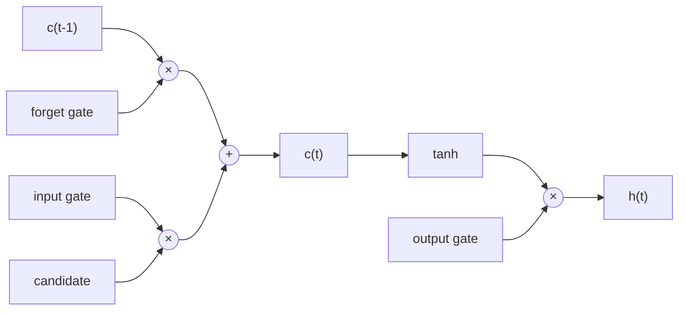
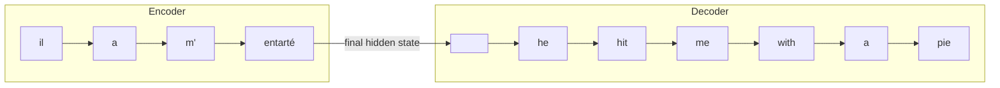
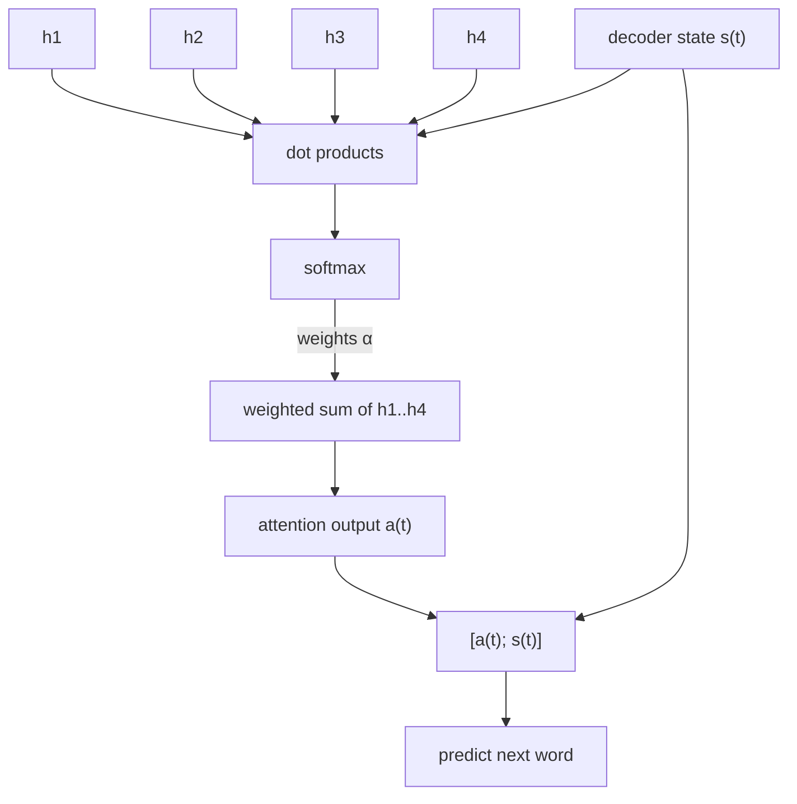
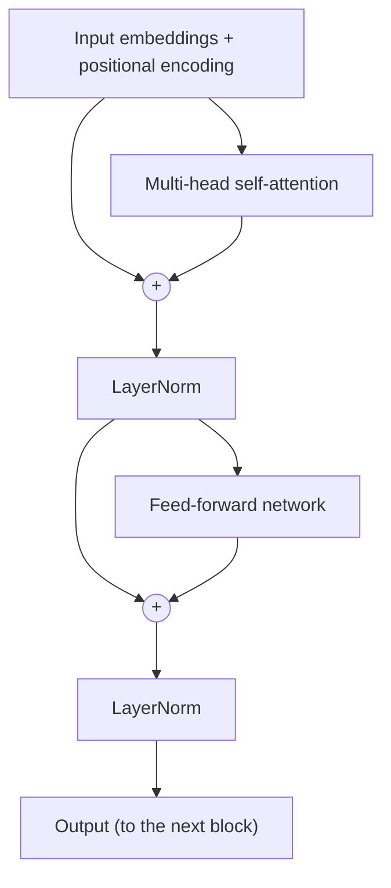
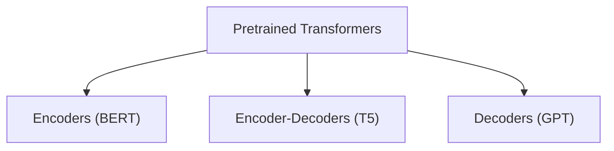
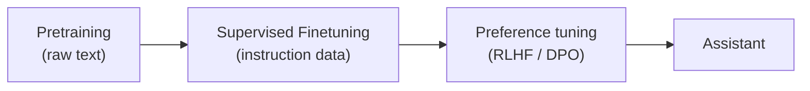
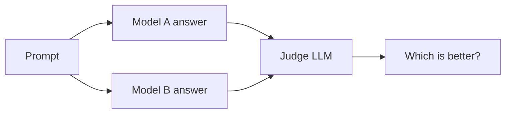
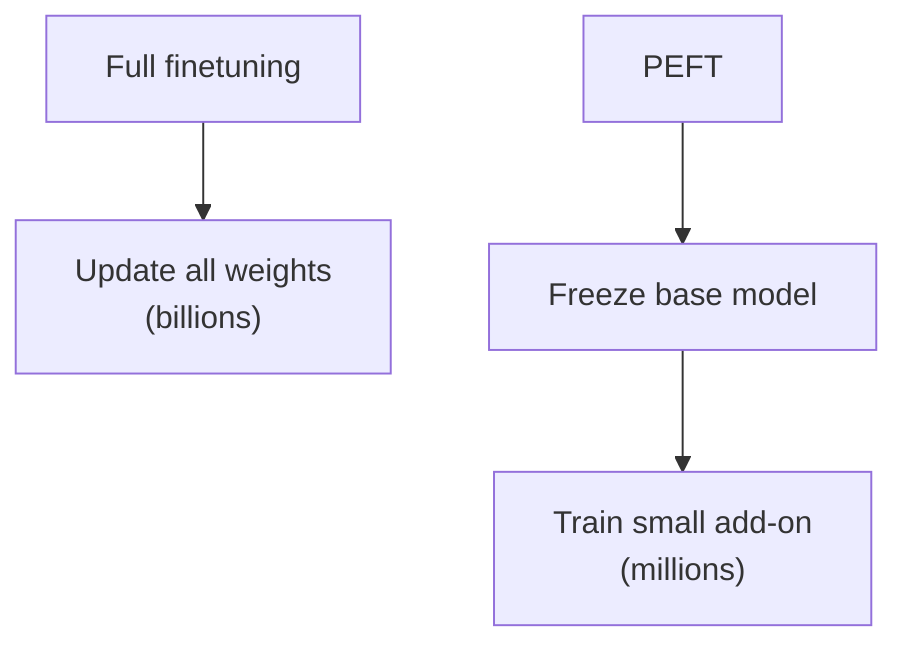
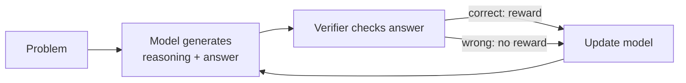
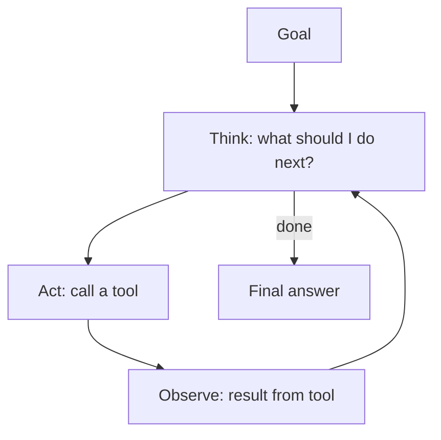

# Lecture 6: LSTMs, GRUs, Seq2Seq and Machine Translation

Last lecture we ended with vanilla RNNs and their vanishing gradient problem. This lecture is about the fixes, and then using them for something real, which is machine translation.

## Why do vanilla RNNs forget?

At each step, the hidden state gets multiplied by the same weight matrix and squished through an activation. After 20 or 30 steps, whatever the first word contributed has either vanished or exploded. So the model basically can't remember stuff from far back.

In a sentence like *"The cats, which were sitting on the old couch in the living room, **are** hungry"*, the model needs to remember that "cats" is plural all the way to the word "are". A vanilla RNN struggles with this.

## LSTMs (Long Short-Term Memory)

The idea is to give the network a separate **memory lane** called the **cell state** $c_t$, and let it learn when to write to it, when to erase from it, and when to read from it. These are controlled by **gates**. A gate is just a sigmoid, so it outputs values between 0 (closed) and 1 (open).

There are three gates:

1. **Forget gate** $f_t$: what should I erase from the cell state?
2. **Input gate** $i_t$: what new stuff should I write to the cell state?
3. **Output gate** $o_t$: what part of the cell state should I show as the hidden state?

$$
f_t = \sigma(W_f [h_{t-1}, x_t] + b_f)
$$
$$
i_t = \sigma(W_i [h_{t-1}, x_t] + b_i)
$$
$$
o_t = \sigma(W_o [h_{t-1}, x_t] + b_o)
$$

New candidate content:
$$
\tilde{c}_t = \tanh(W_c [h_{t-1}, x_t] + b_c)
$$

Update the cell and compute the hidden state:
$$
c_t = f_t \circ c_{t-1} + i_t \circ \tilde{c}_t
$$
$$
h_t = o_t \circ \tanh(c_t)
$$



### Why does this fix the vanishing gradient?

Look at the line $c_t = f_t \circ c_{t-1} + i_t \circ \tilde{c}_t$. The cell state is updated by **addition**, not by repeatedly multiplying with a weight matrix. If the forget gate stays close to 1, the information (and the gradient) flows through the cell state almost untouched. This gives the gradient a clean highway to travel back through time.

Note that it doesn't *guarantee* no vanishing gradients, it just makes it a lot easier for the model to learn long-term dependencies.

## GRUs (Gated Recurrent Units)

GRUs are the lighter cousin. There's no separate cell state, just the hidden state, and only two gates:

- **Update gate** $z_t$: how much of the old state to keep vs. replace
- **Reset gate** $r_t$: how much of the old state to look at when computing new content

$$
h_t = (1 - z_t) \circ h_{t-1} + z_t \circ \tilde{h}_t
$$

Fewer parameters, so faster to train. In practice, performance is pretty similar to LSTMs. A good rule: LSTM is the default, try a GRU if you want speed.

## Bidirectional and multi-layer RNNs

- **Bidirectional:** run one RNN left to right and another right to left, then concatenate the hidden states. Now each word's representation knows about both its left and right context. This is only possible if you have the whole sentence (so fine for NER, not for generating text).
- **Multi-layer (stacked):** the hidden states of layer 1 become the inputs to layer 2. Deeper layers can learn more abstract features. 2 to 4 layers is typical for RNNs.

## Machine Translation

The task: take a sentence in a source language, and output a sentence in a target language.

Before neural nets, this was done with Statistical MT (SMT), which was a huge system with a ton of hand-engineered parts. Neural MT replaced all of it with a single network.

## Seq2Seq

A seq2seq model has two RNNs:

1. **Encoder:** reads the source sentence and compresses it into a vector.
2. **Decoder:** takes that vector and generates the target sentence word by word.



The decoder is basically a **conditional language model**. It's a language model (predicting the next word), but conditioned on the source sentence.

### Training

We have pairs of sentences. At each decoder step, we compute the cross entropy loss between the predicted word and the actual word, then sum these up. We then backprop through the whole thing, decoder and encoder together, end to end.

**Teacher forcing:** during training, we feed the decoder the *actual* previous word, not what it predicted. Otherwise early mistakes would snowball and training would be unstable.

### Decoding

At test time, we don't have the actual words, so we need to pick them.

- **Greedy decoding:** pick the highest probability word at each step. Problem: if you make one wrong choice, you can't go back.
- **Beam search:** keep track of the top $k$ partial translations (the beam size) at every step. At the end, pick the one with the best overall score. $k$ is usually 5 to 10. Bigger $k$ is more expensive, and gives diminishing returns.

### The bottleneck problem

Look at the encoder again. The entire source sentence has to be squeezed into **one fixed size vector** (the final hidden state). For a 5 word sentence, this is fine. For a 50 word sentence, it's a disaster.

This is exactly the problem that attention was built to solve, and that's the next lecture.

## Evaluating MT: BLEU

BLEU compares the machine translation against one or more human translations by counting overlapping n-grams (1 to 4), and adds a penalty for being too short.

It's not perfect. A perfectly good translation worded differently from the reference will score low. But it's cheap, so everyone uses it.

---

# Lecture 7: Attention

We ended the last lecture with the bottleneck problem: the encoder has to cram a whole sentence into one vector, and the decoder has to make do with that.

Attention is the answer, and it's one of the most important ideas in the whole course.

## The idea

When a human translates a sentence, they don't memorize the whole thing and then write it out. They look back at the source sentence as they go, focusing on the part that matters for the word they're writing right now.

So we do the same. At every decoder step, we let the decoder **look directly at all the encoder hidden states** and choose which ones to focus on.

## How it works

Say the encoder gives us hidden states $h_1, h_2, ..., h_N$. At decoder step $t$, we have the decoder hidden state $s_t$.

**Step 1: Attention scores.** Take the dot product of $s_t$ with every encoder hidden state.

$$
e^t = [s_t^T h_1, \ldots, s_t^T h_N] \in \mathbb{R}^N
$$

(A high dot product means "these two are similar", same intuition as word2vec.)

**Step 2: Attention distribution.** Pass these through a softmax so that they sum to 1.

$$
\alpha^t = \text{softmax}(e^t)
$$

**Step 3: Attention output.** Take the weighted sum of the encoder hidden states, using the attention distribution as weights.

$$
a_t = \sum_{i=1}^{N} \alpha_i^t h_i
$$

**Step 4:** Concatenate $a_t$ with $s_t$ and use that to predict the next word.



So if the decoder is about to produce "pie", the attention distribution will have most of its weight on the encoder state for "entarté". Nice and intuitive.

## Why is this so good?

- **It fixes the bottleneck.** The decoder isn't limited to a single vector any more.
- **Helps with vanishing gradients.** There's now a direct shortcut from the decoder to every encoder state.
- **It's interpretable.** We can plot the attention weights as a grid and see which source words the model was looking at for each target word. It basically learns word alignment *for free*, without anybody telling it to.

```
          il   a    m'   entarté
he        ■    □    □    □
hit       □    □    □    ■
me        □    □    ■    □
with      □    □    □    ■
a         □    □    □    ■
pie       □    □    □    ■
```
(darker = more attention, this is just a toy illustration)

## Attention as a general idea

Here's the more general way to look at it. Attention is:

> Given a set of **values** and a **query**, compute a weighted sum of the values, where the weights depend on the query.

The query "selects" what to take from the values. This is like a soft lookup in a dictionary, where instead of getting one exact match you get a blend of everything, weighted by how well each key matches.

This framing is really important because it's the exact thing the Transformer builds on.

## Other ways to compute the score

Dot product isn't the only option:

- **Basic dot product:** $e_i = s^T h_i$
- **Multiplicative:** $e_i = s^T W h_i$ (learns a matrix in the middle)
- **Additive:** $e_i = v^T \tanh(W_1 h_i + W_2 s)$

The dot product is the simplest and works well. Additive was used in the original attention paper.

---

# Lecture 8: Self-Attention and Transformers

So now we know that attention is great. And we also know that RNNs have a pretty big problem that we haven't talked about yet.

## The problem with RNNs

1. **They're sequential.** To compute $h_t$, you need $h_{t-1}$ first. You can't parallelize across time steps, so training on GPUs is slow.
2. **Linear interaction distance.** For two words that are $k$ words apart, it takes $O(k)$ steps for information to travel between them. Far apart words struggle to interact.

The idea behind the Transformer: **what if we drop the recurrence completely and just use attention?**

## Self-Attention

Before, attention was between the decoder and the encoder. Now, every word attends to **every other word in the same sentence**.

Each word gets turned into three different vectors using three learned weight matrices:

- **Query** $q_i = W^Q x_i$ : what am I looking for?
- **Key** $k_i = W^K x_i$ : what do I contain?
- **Value** $v_i = W^V x_i$ : what do I actually give out if you pick me?

Think of it like a library. The query is what you walk in looking for, the key is the label on each book's spine, and the value is the content inside the book. You compare your query with all the labels, and then read more from the books whose labels match well.

For word $i$:

$$
e_{ij} = q_i^T k_j
$$
$$
\alpha_{ij} = \text{softmax}_j(e_{ij})
$$
$$
\text{output}_i = \sum_j \alpha_{ij} v_j
$$

And in matrix form, for the whole sentence at once:

$$
\text{Attention}(Q, K, V) = \text{softmax}\left(\frac{QK^T}{\sqrt{d_k}}\right) V
$$

### Why divide by $\sqrt{d_k}$?

When $d_k$ is large, the dot products get really large in magnitude, which pushes the softmax into regions where it's almost one-hot and the gradients are tiny. Dividing by $\sqrt{d_k}$ keeps things in a sensible range. This is called **scaled** dot-product attention.

### The good part

All of this is just matrix multiplication, so the whole sentence is computed **in parallel**. And any two words interact directly in one step, no matter how far apart they are.

## Fixing the problems with self-attention

Self-attention on its own has some issues. The Transformer adds a few fixes.

### 1. No notion of order

Self-attention treats the input as a **set**. "Dog bites man" and "Man bites dog" would look identical to it!

**Fix: positional encodings.** We add a vector that depends on the position to each word embedding. The original paper used sine and cosine waves of different frequencies:

$$
PE_{(pos, 2i)} = \sin(pos / 10000^{2i/d})
$$
$$
PE_{(pos, 2i+1)} = \cos(pos / 10000^{2i/d})
$$

Modern models often learn the position embeddings instead, or use relative methods like RoPE.

### 2. No non-linearity

Self-attention is basically just weighted averages. That's not much power.

**Fix: a feed-forward network** applied to each position independently, after attention. It's usually two linear layers with a ReLU or GELU in between, with the hidden layer about 4× as wide.

### 3. Looking into the future

When we're generating text, word $i$ should not see words after it (that would be cheating).

**Fix: masking.** We set the attention score to $-\infty$ for all future positions before the softmax, so they get a weight of 0.

## Multi-head attention

One attention head can only focus on one kind of relationship at a time. But a word might need to look at several things: its subject, its adjective, the previous word, and so on.

So we run **multiple attention heads in parallel**, each with its own $W^Q, W^K, W^V$, each working on a smaller dimension ($d/h$). Then we concatenate all outputs and pass through one more linear layer. The total cost stays about the same as one big head.

## The Transformer block



Two other tricks that make it trainable:

- **Residual connections:** we add the input back to the output of each sub-layer ($x + \text{Sublayer}(x)$). This gives gradients a clean path back (same logic as the LSTM cell state highway).
- **Layer normalization:** normalizes the activations at each layer so training is stable.

Stack 6 to 100+ of these blocks and you have a Transformer.

## Encoder vs Decoder

- **Encoder:** self-attention with no mask (every word sees everything).
- **Decoder:** *masked* self-attention, plus **cross-attention** to the encoder's output (this is the same encoder-decoder attention from last lecture, where queries come from the decoder, and keys and values come from the encoder).

## The catch

Self-attention compares every word to every other word, so the cost is **quadratic**: $O(n^2)$ in the sequence length. This is why long contexts get expensive, and why there's a whole sub-field working on making this cheaper.

---

# Lecture 9: Pretraining

Here's a thing we've been doing so far. Initialize the word vectors with word2vec or GloVe, and then train everything else from scratch. But that leaves the entire rest of the network (the part that figures out syntax, context, and so on) starting from random numbers.

The big idea of this lecture: **why not pretrain the whole network?**

## The pretrain then finetune paradigm

1. **Pretraining:** train a model on a huge pile of raw text, with a task that doesn't need labels. The model has to learn a lot about language to do well.
2. **Finetuning:** take that model and adapt it on your small, labelled dataset.

This works because language modelling forces the model to learn things like grammar, facts about the world, some reasoning, and sentiment, just to predict the next word well.

## Subword models

Before the models, we need to fix an annoying problem. What do we do about words that are not in the vocab? Words like "taaaasty", "Transformerify", or typos?

With a word level vocab, they all become `<UNK>`, and we lose all information.

**Subword tokenization** breaks words into smaller pieces. The most popular method is **Byte-Pair Encoding (BPE)**:

1. Start with a vocab of just individual characters.
2. Find the most frequent pair of adjacent tokens and merge them into a new token.
3. Repeat until you hit the vocab size you want.

So "tasty" is probably a single token, and "taaaasty" might become `ta` + `aaa` + `sty`. Common words stay whole, rare words get broken into pieces, and nothing is ever unknown.

## Three types of pretrained models



### 1. Decoders: GPT

These are just language models. Predict the next word, with masked self-attention so they can't peek.

- Great at **generating** text.
- Only see the left context.
- GPT-1 was pretrained on books, then finetuned on tasks.

### 2. Encoders: BERT

Encoders see both left and right context, so we can't use next word prediction (it would be trivial to cheat). So BERT uses **masked language modelling**:

- Randomly pick 15% of the tokens.
- Replace them with `[MASK]` most of the time (a few get a random word, a few stay unchanged).
- Predict the original word.

*"I went to the [MASK] to buy some milk"* → store.

BERT also had a second task called next-sentence prediction, which later turned out to not matter very much.

- Great for **understanding** tasks: classification, NER, question answering.
- Can't generate text naturally.

### 3. Encoder-Decoders: T5

T5 uses **span corruption**: remove chunks of text, replace each chunk with a special sentinel token, and make the decoder reproduce the missing chunks.

T5 also treated every task as text-to-text, so translation, summarization, and classification were all "put text in, get text out".

## The shift to scale

GPT-2 and GPT-3 showed that if you make decoder-only models bigger and train on more data, they start doing tasks they were never trained for.

### In-context learning

GPT-3 could do a task just by being shown a few examples in the prompt, **with no gradient updates at all**:

```
Translate English to French:
sea otter => loutre de mer
cheese => fromage
hello =>
```

- **Zero-shot:** just describe the task.
- **One-shot / few-shot:** show 1 or a few examples.

### Scaling laws

Loss goes down smoothly and predictably as you increase model size, data and compute. This is why people kept making models bigger. It also gave us the idea of finding the best balance between model size and data for a fixed compute budget (the Chinchilla result said many models were too large for the data they were trained on).

## Why does pretraining help so much?

Honestly, it's a bit mysterious. But a good way to think about it is that predicting the next token on enough text forces the model to compress a lot of knowledge about how the world works into its parameters.

---

# Lecture 10: Post-training (Instruction Tuning and RLHF)

A pretrained language model is a really good *text continuer*, but it's not an *assistant*. If you ask it "How do I bake bread?", it might continue with "How do I bake cake? How do I bake cookies?", because that's what a list of questions on the internet looks like.

Post-training is how we turn that base model into something useful, and safe.



## Step 1: Instruction tuning (SFT)

We collect a dataset of **(instruction, ideal response)** pairs, written by humans. Then we just finetune the model on it with the same next token loss as before.

Some findings:
- You don't need *that much* data. A few thousand good examples can go a long way.
- **Quality matters more than quantity.**
- Training on a huge variety of tasks makes the model generalize to unseen instructions.

### The limits of SFT

- Writing good responses is expensive.
- It only teaches the model to imitate. It never learns what *not* to do.
- Humans are often better at **judging** two answers than at writing a perfect one from scratch. This is the key insight that leads us to the next step.

## Step 2: Learning from human preferences

Instead of asking humans to write answers, we ask them to **rank** them. The model produces two answers to the same prompt, and a human says which one is better.

### RLHF (Reinforcement Learning from Human Feedback)

**Part A: Train a reward model.**

We train a model $R(x, y)$ that takes a prompt $x$ and response $y$ and outputs a single number: how good it is. We train it on the preference pairs, so that the preferred answer $y_w$ gets a higher score than the rejected one $y_l$.

$$
\mathcal{L} = -\log \sigma\left(R(x, y_w) - R(x, y_l)\right)
$$

(This is the Bradley-Terry model. It just says the probability of preferring one answer over another depends on the difference of their scores.)

**Part B: Optimize the language model against the reward model with RL.**

We treat the LM as a policy, and use an algorithm like **PPO** to make it generate responses that get high reward.

But there's a catch. If we only maximize reward, the model will find weird ways to cheat the reward model (**reward hacking**), producing gibberish that scores high. So we add a **KL penalty** that keeps the model close to the original SFT model:

$$
\max_\pi \; \mathbb{E}\left[R(x, y)\right] - \beta \, D_{KL}\left(\pi \,\|\, \pi_{ref}\right)
$$

### The problem with RLHF

It's complicated and unstable. You have to juggle 4 models at once (policy, reference, reward model, value model), and PPO is notoriously hard to tune.

## DPO (Direct Preference Optimization)

DPO shows that you can **skip the reward model and the RL entirely**. With some math, the RLHF objective can be rewritten as a simple classification-style loss directly on the preference pairs:

$$
\mathcal{L}_{DPO} = -\log \sigma\left(\beta \log \frac{\pi_\theta(y_w|x)}{\pi_{ref}(y_w|x)} - \beta \log \frac{\pi_\theta(y_l|x)}{\pi_{ref}(y_l|x)}\right)
$$

In words: increase the probability of the good answer, decrease the probability of the bad one, relative to the reference model. No sampling, no reward model. Just a supervised-like training loop.

It's way simpler, and it's become really popular. People still debate whether it's as good as proper RL at the very top end.

## Some issues to keep in mind

- **Human preferences are noisy.** People disagree with each other.
- **Models can learn to flatter.** Humans tend to prefer longer and more confident-sounding answers, and models pick up on that, even when the answer is wrong.
- **Hallucination.** Post-training doesn't magically fix it, and teaching a model to say "I don't know" is still hard.
- **Safety vs helpfulness tradeoff.** Too much safety training and the model refuses harmless questions.

---

# Lecture 11: Benchmarking and Evaluation

We've built these giant models. Now the question is, how do we know if they're any good? Turns out this is a really hard question, and honestly it's one of the messiest parts of the field right now.

## Why is evaluation hard?

For classification, it's easy. You have a label, the model is right or wrong, you compute accuracy. Done.

For language models, the output is open ended. Ask "Write me a poem about rain" and there is no single right answer. So how do we score it?

## Perplexity

The oldest metric. Perplexity measures how surprised the model is by the actual next words in some held-out text.

$$
\text{PPL} = \exp\left(-\frac{1}{T}\sum_{t=1}^{T} \log P(w_t \mid w_{<t})\right)
$$

Lower is better. A perplexity of 20 means the model is about as confused as if it were choosing between 20 equally likely words at each step.

Good for comparing language models during pretraining. But it doesn't tell you if the model is actually useful, and you can't compare perplexity between models with different tokenizers.

## Benchmarks

The standard approach is to build a fixed test set with right answers and see how many the model gets right.

- **MMLU:** multiple choice questions across 57 subjects (law, medicine, math, history...). Tests knowledge.
- **GSM8K:** grade school math word problems. Tests multi-step reasoning.
- **HumanEval:** write a Python function, and we run unit tests on it. Tests coding.
- **HELM:** not a single benchmark, but a framework that evaluates models on lots of scenarios and lots of metrics (accuracy, calibration, robustness, toxicity...) together.

For multiple choice, evaluation is easy. For things like summarization, people used metrics like ROUGE (n-gram overlap with a reference), but just like BLEU in MT, it misses good answers that are worded differently.

## The problems with benchmarks

### 1. Saturation
Models get 90%+ on a benchmark, and then it can't tell good models from great ones. So we need to keep building harder ones.

### 2. Contamination
The test set might be in the training data. If the model has already seen the questions and answers on the internet, a high score doesn't mean it's smart, it just means it memorized. It's hard to check this since we usually don't know exactly what's in the training data.

### 3. Sensitivity to the prompt
Just changing the format of the question, like the order of the multiple choice options, or whether you write "A)" or "(A)", can change scores by a surprising amount.

### 4. Goodhart's law
> When a measure becomes a target, it ceases to be a good measure.

If everyone is optimizing for the same leaderboard, the models become good at the leaderboard, not necessarily at the real world.

## Human evaluation

The gold standard. Just get humans to look at the outputs.

**Chatbot Arena:** you chat with two anonymous models side by side, and then vote for the better one. Votes are turned into rankings using an Elo-style rating system. It's closer to real usage because users bring their own prompts.

The downsides:
- It's slow and expensive.
- Humans have biases. They like longer answers, confident answers, and nicely formatted answers, even when they're wrong.
- Not reproducible.

## LLM as a judge

A cheaper idea: use a strong LLM to grade the outputs of other models.



It correlates pretty well with human preferences, and it's scalable. But the judge has biases too:

- **Position bias:** prefers whichever answer is shown first.
- **Verbosity bias:** prefers longer answers.
- **Self-preference:** tends to favour answers that look like its own style.

A common fix is to run it twice with the order swapped, and only count it if the judgment is consistent.

## Takeaway

No single number tells you if a model is good. You need to look at a mix: benchmarks, human preference, and (most importantly) testing on your own actual use case.

---

# Lecture 12: Efficient Adaptation and Training

Models now have billions of parameters. This lecture is about a very practical question: how do we actually train and adapt them without needing a data center?

## Why is this a problem?

Take a 7 billion parameter model. Just storing the weights in 16-bit takes about 14 GB. But training needs a lot more than that:

- the weights
- the gradients (same size as the weights)
- the optimizer states (Adam stores 2 extra numbers per parameter)
- the activations

So full finetuning of a 7B model needs many times the memory of just loading it. For anything larger, one GPU is simply not enough.

## Full finetuning vs. its problems

Finetuning every parameter for every new task means:
- huge memory cost
- a full copy of the model for every task you finetune it for (a nightmare to store and serve)
- risk of **catastrophic forgetting**, where the model gets worse at what it knew before

## Parameter-Efficient Finetuning (PEFT)

The idea: **freeze the pretrained model, and only train a tiny number of extra parameters.**



### Adapters
Insert small bottleneck layers (down-project, non-linearity, up-project) inside each Transformer block, and train only those. Works, but adds a bit of latency at inference.

### Prefix / prompt tuning
Add some learnable "virtual token" vectors at the start of the input (or at every layer) and only train those. Super cheap, but tends to work worse on smaller models.

### LoRA (Low-Rank Adaptation)

This is the most popular one. The insight is that the *change* to a weight matrix during finetuning has a **low intrinsic rank**. So instead of learning a full update $\Delta W$ of size $d \times d$, we learn it as a product of two skinny matrices:

$$
W' = W + \Delta W = W + BA
$$

where $B \in \mathbb{R}^{d \times r}$, $A \in \mathbb{R}^{r \times d}$, and $r \ll d$ (like 4, 8, or 16).

```
 frozen W (d × d)
        |
x ------+--------------------> (+) --> output
        |                       ^
        +--> A (r × d) --> B (d × r)
              (trainable)
```

Let's see why this is so nice with an example. Say $d = 4096$ and $r = 8$.

- Full update: $4096 \times 4096 \approx 16.8M$ parameters per matrix.
- LoRA: $2 \times 4096 \times 8 \approx 65K$ parameters per matrix.

That's about 250× smaller.

Other nice things:
- $B$ is initialized to zero, so at the start $\Delta W = 0$ and the model behaves exactly like the pretrained model.
- After training you can **merge** $BA$ into $W$, so there's zero extra cost at inference.
- You can keep one base model and swap in tiny LoRA files for different tasks.

## Quantization

Another angle: make each parameter take less memory.

Instead of 16-bit floats, store weights in 8-bit or even 4-bit integers. A 4-bit model takes about a quarter of the memory of the 16-bit one.

**QLoRA** combines the two: keep the base model frozen in 4-bit, and train LoRA adapters on top in higher precision. This is what let people finetune big models on a single consumer GPU.

The cost is a small drop in quality, usually tolerable.

## Mixed precision training

Do most of the math in 16-bit (faster, less memory), but keep a master copy of weights in 32-bit so small updates don't get rounded away to nothing. bfloat16 is popular because it has the same range as 32-bit floats, so it avoids overflow issues.

## Training across many GPUs

When a model doesn't fit on one GPU:

- **Data parallelism:** every GPU holds a full copy of the model, and each gets different data. Gradients are averaged across GPUs.
- **Model / tensor parallelism:** split the model's layers or matrices across GPUs.
- **Sharding (ZeRO / FSDP):** like data parallelism, but the weights, gradients and optimizer states are *split* across GPUs, and gathered only when needed. This saves a ton of memory.

## Takeaway

For most people, the recipe is: take a pretrained model, quantize it, add LoRA, and finetune on your data. You get most of the benefit at a tiny fraction of the cost.

---

# Lecture 13: Reasoning and Agents

So far, our models predict the next token. That's it. But these models can now solve math problems, write code, and use tools. This lecture is about how we got from "autocomplete" to that.

## Chain-of-Thought (CoT)

The first big discovery was really simple. If you ask a model a multi-step question and ask for the answer directly, it often gets it wrong. But if you get it to **write out its steps first**, it does way better.

```
Q: Roger has 5 balls. He buys 2 cans of 3 balls each. How many balls now?

Direct answer: 11   (sometimes it just guesses)

With reasoning:
Roger starts with 5. 2 cans × 3 balls = 6 balls. 5 + 6 = 11.
The answer is 11.
```

Why does this work? A Transformer only does a fixed amount of computation per token. Writing out intermediate steps gives the model more "thinking time", and the intermediate results are written into the context where it can use them.

Even just adding "Let's think step by step" to the prompt helps (zero-shot CoT).

## Improving on plain CoT

### Self-consistency
Sample multiple reasoning paths (with some randomness), take the final answer from each, and go with the **majority vote**. If a problem has one right answer but many ways to reach it, wrong paths tend to disagree with each other, while right paths tend to agree.

### Tree / search methods
Instead of one chain, explore multiple branches of reasoning, evaluate how promising each one is, and prune the bad ones. More compute, better answers on hard problems.

## Training models to reason

Prompting only gets you so far. The newer idea is to **train** the model to reason well, using reinforcement learning.

The setup works best when we can **automatically verify** the answer:
- Math: does the final answer match the known solution?
- Code: do the unit tests pass?



No human labels the reasoning steps. The model only gets a reward for the final result, and RL pushes it towards whichever kinds of reasoning lead to correct answers. Interestingly, behaviours like double-checking, backtracking, and trying a different approach start to **emerge** on their own.

This is called **RL with verifiable rewards**, and it's what's behind the "reasoning models" that think for a long time before answering.

### Test-time compute
This gives us a new axis for scaling. Before, we scaled by making the model bigger or training on more data. Now we can also scale by letting the model **think for longer at inference time**. For hard problems, spending more tokens on reasoning gives better answers.

The tradeoff is cost and latency, since long reasoning means more tokens to generate.

## Language model agents

A normal chatbot answers once. An **agent** is an LLM that can take actions in a loop to reach a goal.

The core loop:



This is basically the **ReAct** pattern (Reason + Act): the model alternates between writing out its thoughts and calling tools, and the tool outputs get fed back into its context.

### Tools
A tool is just a function the model can call: a search engine, a calculator, a code interpreter, a database query, a browser, an API. The model writes out the call in a structured format (like JSON), the system runs it, and the result goes back into the context.

This fixes some of the weaknesses of LLMs:
- Can't do exact arithmetic → use a calculator or write code.
- Knowledge is frozen at training time → search the web.
- Can't act on the world → call APIs.

### Memory and planning
Agents working on long tasks need a way to remember what they've done, which is usually a mix of the context window and external storage they can read and write. They also often **plan** first, breaking a big goal into smaller steps.

## The challenges

- **Errors compound.** If each step is 90% reliable, then a 10 step task only succeeds about 35% of the time ($0.9^{10}$).
- **Long horizons.** Models can lose track of the goal or get stuck in loops.
- **Safety.** Letting a model take real actions (send emails, run code, spend money) means mistakes have real consequences. This needs sandboxing, permissions, and human oversight.
- **Evaluation.** It's much harder to evaluate a multi-step agent than a single answer.

## Takeaway

The trend is: models don't just generate text anymore. They think before answering (reasoning), and act in the world (agents). Both are built on the same Transformer, just trained and used in a smarter way.
