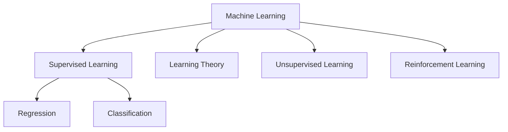
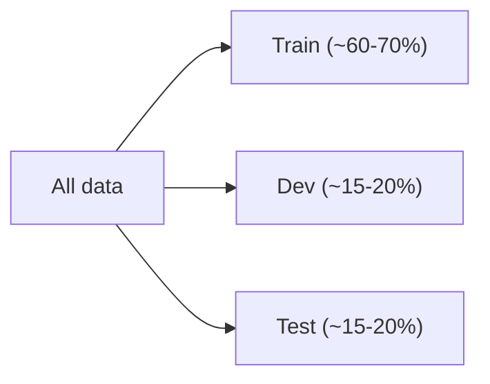
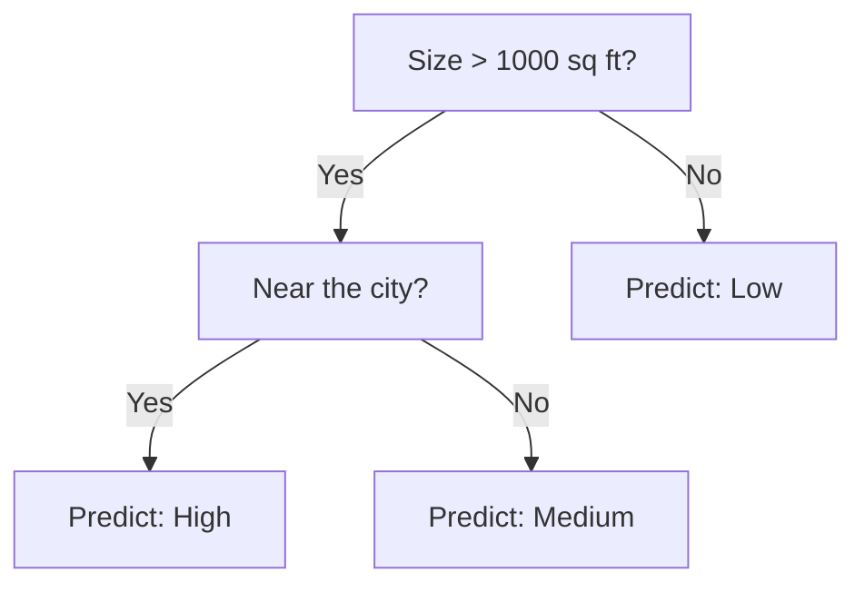
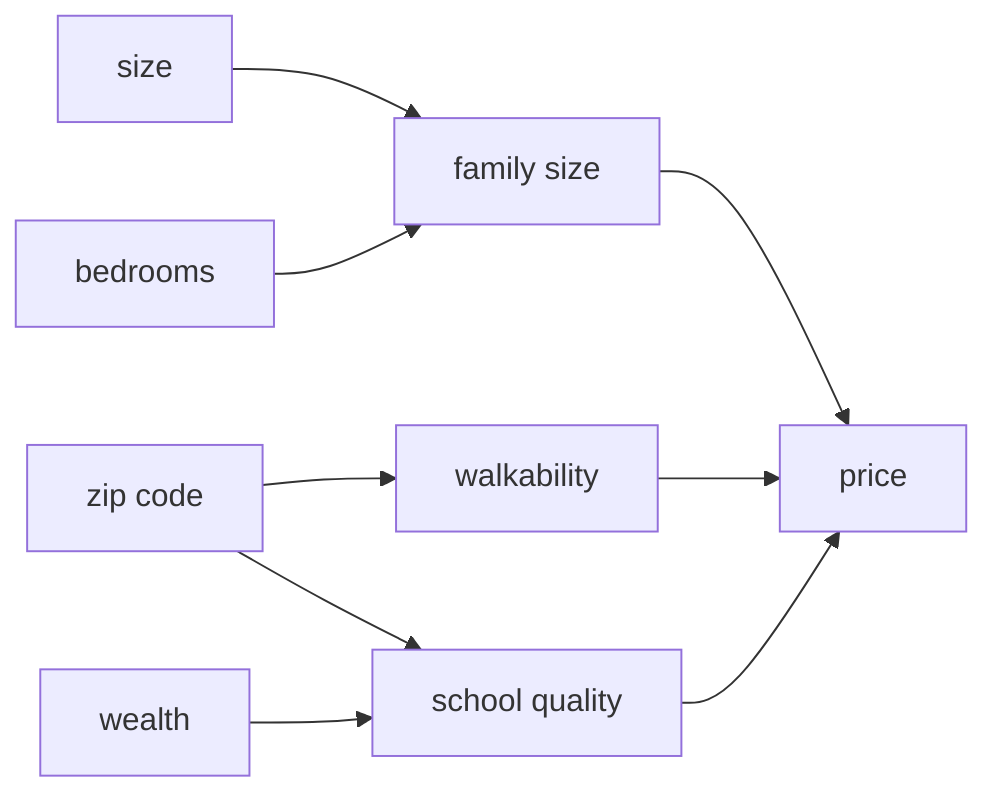
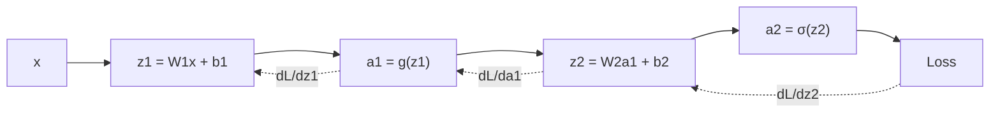
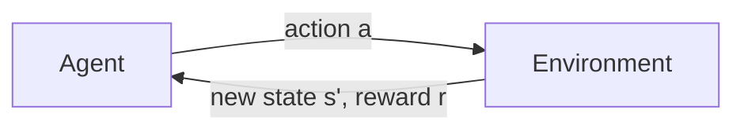
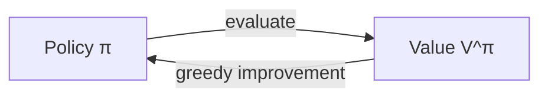
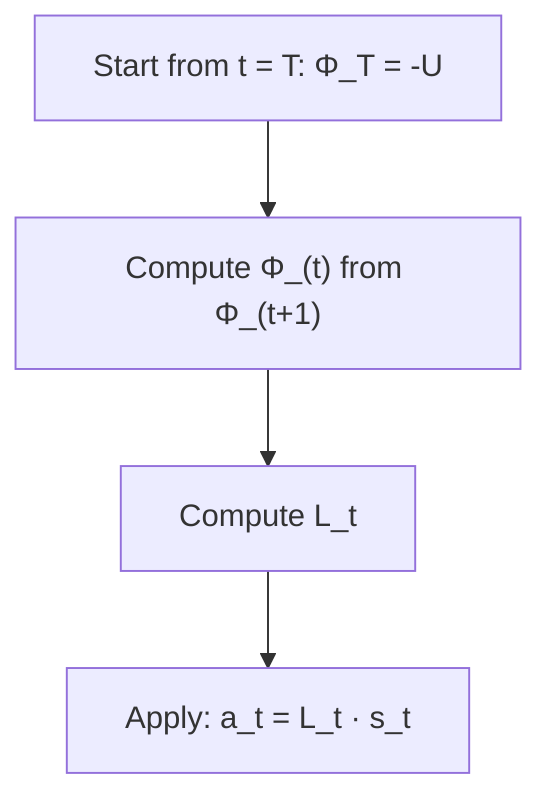
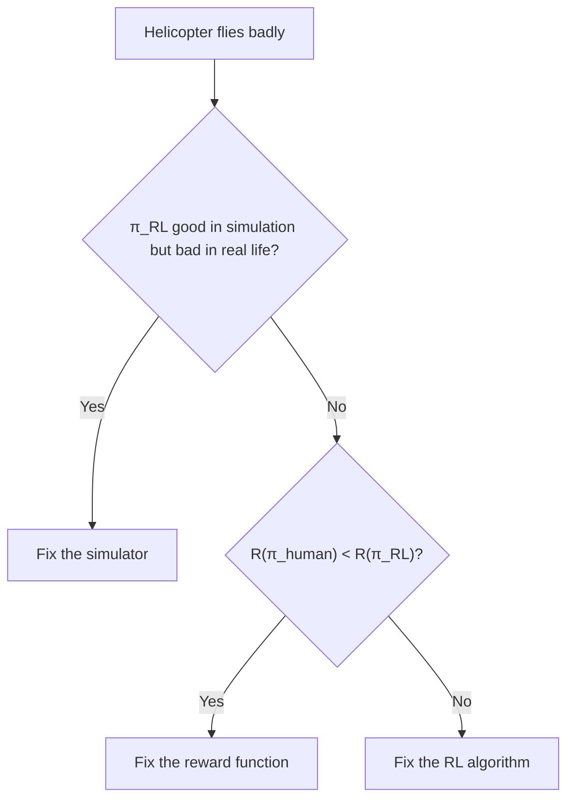

# Lecture 1: Introduction to Machine Learning

## The Course

- Broad introduction to machine learning and statistical pattern recognition.
- Four big buckets we'll go through:
    - Supervised learning
    - Learning theory
    - Unsupervised learning
    - Reinforcement learning
- Lots of math (linear algebra, probability), and lots of practical advice on actually making things work.

## What is Machine Learning?

Arthur Samuel's definition (old school): *the field of study that gives computers the ability to learn without being explicitly programmed.* He wrote a checkers program that played against itself thousands of times and ended up better than him.

Tom Mitchell's definition (more formal):

> A program is said to learn from experience **E** with respect to some task **T** and performance measure **P**, if its performance on **T**, as measured by **P**, improves with experience **E**.

For checkers: **E** is games played against itself, **T** is playing checkers, **P** is the chance of winning the next game.

## Supervised Learning

This is the most common type. You give the algorithm both the inputs **x** and the right answers **y**, and it learns the mapping $x \rightarrow y$.

Housing prices is the classic example. You have the size of the house (x) and the price (y). Fit a line, and predict the price of a new house.

```
price
  |            . 
  |         .  /
  |      . /.
  |    . /
  |  ./ .
  |_/_________ size
```

- **Regression:** the thing you predict is continuous (price).
- **Classification:** the thing you predict is discrete (tumor is malignant or benign).

And if we have more than one feature (size, age of tumor, cell shape...), then x becomes a vector, and we're drawing a decision boundary in a higher dimensional space. Some algorithms can even work with an **infinite** number of features, which is what we'll see with SVMs and kernels.

## Learning Theory

When does an algorithm work, and when doesn't it? How much data do I need? Why does it overfit? This part of the course is about understanding those things, so you can make good decisions instead of just trying things randomly.

## Unsupervised Learning

Now we only have **x**, with no labels. Find structure in the data.

- Clustering (group similar things, like market segmentation or grouping genes)
- The cocktail party problem: you have two microphones in a room with two people talking, and you want to separate the two voices. Surprisingly, this can be done with just a few lines of code (ICA, which we'll get to).

## Reinforcement Learning

There's no right answer given for each step. Instead you have a **reward function** that tells the agent if it's doing well or badly. Think of training a dog: you don't tell it exactly what to do, you just give it a treat when it does something good. An example is flying an autonomous helicopter.



## One more thing

Andrew keeps saying that having the algorithms is only half the battle. The other half is knowing how to apply them. Two people can use the same algorithm, and one will get it working in a week while the other wastes six months. A lot of this course is about being the first person.

---

# Lecture 2: Linear Regression and Gradient Descent

## Setting up

Notation we'll use for the whole course:

- $m$ = number of training examples
- $n$ = number of features
- $x^{(i)}$ = input features of the $i$-th example
- $y^{(i)}$ = output of the $i$-th example
- $(x^{(i)}, y^{(i)})$ = one training example

The job of a supervised learning algorithm is to learn a function $h: X \rightarrow Y$. This $h$ is called the **hypothesis**.

For linear regression we choose:

$$
h_\theta(x) = \theta_0 + \theta_1 x_1 + \dots + \theta_n x_n = \sum_{j=0}^{n} \theta_j x_j = \theta^T x
$$

(We set $x_0 = 1$ so that the intercept term fits neatly into the sum.)

## Picking the parameters

We want $h_\theta(x)$ to be close to $y$ on the training examples. So we define a cost function, the sum of squared errors:

$$
J(\theta) = \frac{1}{2} \sum_{i=1}^{m} \left(h_\theta(x^{(i)}) - y^{(i)}\right)^2
$$

and choose the $\theta$ that minimizes $J(\theta)$. The $\frac{1}{2}$ is there only to make the derivative cleaner.

## Gradient Descent

Start with some random $\theta$ (say all zeros), and keep updating:

$$
\theta_j := \theta_j - \alpha \frac{\partial}{\partial \theta_j} J(\theta)
$$

$\alpha$ is the **learning rate**.

Intuition: imagine standing on a hill, looking around 360 degrees, and taking a small step in the steepest downhill direction. Keep doing that and you end up at the bottom.

Working out the derivative for one training example:

$$
\frac{\partial}{\partial \theta_j} \frac{1}{2}(h_\theta(x) - y)^2 = (h_\theta(x) - y) x_j
$$

So for all examples, the update is:

$$
\theta_j := \theta_j + \alpha \sum_{i=1}^{m} \left(y^{(i)} - h_\theta(x^{(i)})\right) x_j^{(i)}
$$

### Why is there only one minimum?

For linear regression, $J(\theta)$ is a **convex quadratic function**, so it looks like a bowl. There are no local minima, only one global minimum. That's why gradient descent works so well here.

### Batch vs Stochastic Gradient Descent

- **Batch gradient descent:** use all $m$ examples for each single step. Gets very slow when $m$ is huge (millions).
- **Stochastic gradient descent (SGD):** use only one example for each step, and sweep through the data again and again. It doesn't converge perfectly (it keeps wiggling around the minimum), but it gets close really fast.

For big datasets, SGD is almost always what people use. (Mini-batch is the happy middle ground.)

### Picking the learning rate

- Too big: you overshoot, bounce around, and might even diverge.
- Too small: it works, but takes forever.

A good habit is to plot $J(\theta)$ against the number of iterations. It should go down smoothly. If it doesn't, change $\alpha$.

## The Normal Equation

For linear regression, we can skip gradient descent entirely and just solve for $\theta$ directly.

Stack the examples as rows in a matrix $X$ (size $m \times (n+1)$) and the labels into a vector $y$. Then $J(\theta) = \frac{1}{2}(X\theta - y)^T(X\theta - y)$.

Set the gradient to zero:

$$
\nabla_\theta J(\theta) = X^T X \theta - X^T y = 0
$$

$$
\theta = (X^T X)^{-1} X^T y
$$

One line, no learning rate, no iterations.

The catch: inverting $X^T X$ costs roughly $O(n^3)$, so it's slow when you have a lot of features (tens of thousands). Then gradient descent wins.

---

# Lecture 3: Locally Weighted Regression and Logistic Regression

## Why least squares? The probabilistic view

Why should we use the *squared* error? Why not absolute error or something else? Here's a justification.

Assume the target is the linear prediction plus some noise:

$$
y^{(i)} = \theta^T x^{(i)} + \epsilon^{(i)}, \quad \epsilon^{(i)} \sim \mathcal{N}(0, \sigma^2)
$$

That means $y^{(i)} \mid x^{(i)}; \theta \sim \mathcal{N}(\theta^T x^{(i)}, \sigma^2)$. Now write the likelihood of the data and take the log:

$$
\ell(\theta) = m \log \frac{1}{\sqrt{2\pi}\sigma} - \frac{1}{\sigma^2} \cdot \frac{1}{2}\sum_{i=1}^m (y^{(i)} - \theta^T x^{(i)})^2
$$

Maximizing this is the exact same as minimizing the sum of squared errors. So least squares **is** maximum likelihood under Gaussian noise. Nice.

## Parametric vs Non-parametric

- **Parametric:** fixed number of parameters, and once trained, you can throw away the training data (linear regression).
- **Non-parametric:** the number of parameters grows with the training set size, so you need to keep the data around.

## Locally Weighted Regression (LWR)

Problem: if the data isn't linear, a straight line fits badly, and you'd have to pick features by hand.

The idea: to make a prediction at a point $x$, only look at the training examples **near $x$**, and fit a line just to those.

For each query point $x$, fit $\theta$ to minimize:

$$
\sum_{i} w^{(i)} \left(y^{(i)} - \theta^T x^{(i)}\right)^2
$$

where the weights are:

$$
w^{(i)} = \exp\left(-\frac{(x^{(i)} - x)^2}{2\tau^2}\right)
$$

- If $x^{(i)}$ is close to $x$, the weight is about 1.
- If it's far, the weight is about 0.

$\tau$ is the **bandwidth**. Small $\tau$ means only very close points matter (wiggly fit, risk of overfitting). Big $\tau$ means more points matter (smoother, closer to plain linear regression).

The downside is that you have to refit for every prediction, and you keep the whole training set. It's great for small, low dimensional datasets.

## Classification and Logistic Regression

Now $y \in \{0, 1\}$. Using linear regression for this is a bad idea (one far away outlier can drag the line and mess up the threshold). Plus $h$ would output values way above 1 or below 0.

So we choose:

$$
h_\theta(x) = g(\theta^T x) = \frac{1}{1 + e^{-\theta^T x}}
$$

where $g$ is the **sigmoid** (logistic) function. It squashes everything into $(0, 1)$.

```
 1 |            ______
   |          /
.5 |        /
   |      /
 0 |_____/
   +---------------- z
```

We interpret the output as a probability:

$$
P(y = 1 \mid x; \theta) = h_\theta(x), \quad P(y = 0 \mid x; \theta) = 1 - h_\theta(x)
$$

Combined: $p(y \mid x; \theta) = h_\theta(x)^y (1 - h_\theta(x))^{1-y}$.

### Fitting it

Maximize the log likelihood:

$$
\ell(\theta) = \sum_{i=1}^{m} y^{(i)} \log h(x^{(i)}) + (1 - y^{(i)}) \log (1 - h(x^{(i)}))
$$

Gradient **ascent** (since we're maximizing):

$$
\theta_j := \theta_j + \alpha \sum_{i=1}^{m} \left(y^{(i)} - h_\theta(x^{(i)})\right) x_j^{(i)}
$$

Wait, that looks identical to the linear regression update! It is, in form. The only difference is that $h_\theta(x)$ is now the sigmoid. This isn't a coincidence, and we'll see why in the lecture on GLMs.

## Newton's Method

A faster way to maximize $\ell(\theta)$. To find where $\ell'(\theta) = 0$, Newton's method repeatedly approximates the function with a tangent line and jumps to where that line hits zero:

$$
\theta := \theta - \frac{\ell'(\theta)}{\ell''(\theta)}
$$

For a vector of parameters:

$$
\theta := \theta - H^{-1} \nabla_\theta \ell(\theta)
$$

where $H$ is the **Hessian** (matrix of second derivatives).

- Converges in very few iterations (quadratic convergence, the number of correct digits roughly doubles each step).
- Each iteration is expensive, because you need to compute and invert an $(n+1) \times (n+1)$ matrix.

So Newton's method is great when $n$ is small (say, up to a few thousand), and a pain when it's huge.

---

# Lecture 4: Perceptron and Generalized Linear Models

## The Perceptron

Take logistic regression, but replace the smooth sigmoid with a hard threshold:

$$
g(z) = \begin{cases} 1 & \text{if } z \geq 0 \\ 0 & \text{if } z < 0 \end{cases}
$$

with $h_\theta(x) = g(\theta^T x)$. The update rule looks the same as before:

$$
\theta_j := \theta_j + \alpha \left(y^{(i)} - h_\theta(x^{(i)})\right) x_j^{(i)}
$$

What does this do?

- If the prediction is right, $y - h = 0$, so nothing changes.
- If it predicts 0 but the answer is 1, $y - h = 1$, so we add $\alpha x$ to $\theta$ (rotate the boundary towards classifying that point as 1).
- If it predicts 1 but the answer is 0, we subtract.

The perceptron has no probabilistic interpretation. It just says 0 or 1, with nothing about how confident it is. That's one reason it isn't used much today, but it was historically important for neural nets.

## The Exponential Family

Here's something that ties linear regression and logistic regression together. A distribution is in the **exponential family** if it can be written as:

$$
p(y; \eta) = b(y) \exp\left(\eta^T T(y) - a(\eta)\right)
$$

- $\eta$ = natural parameter
- $T(y)$ = sufficient statistic (usually just $y$)
- $a(\eta)$ = log partition function (makes it normalize to 1)

Lots of distributions fit this: Gaussian, Bernoulli, Poisson, Gamma, Beta, Dirichlet...

**Example: Bernoulli** with parameter $\phi$. We get $\eta = \log\frac{\phi}{1-\phi}$. Invert it and you get $\phi = \frac{1}{1+e^{-\eta}}$, the sigmoid! That's where it comes from.

## Generalized Linear Models (GLMs)

A GLM is a recipe. Say you want to model $y$ given $x$. Make three assumptions:

1. $y \mid x; \theta \sim \text{ExponentialFamily}(\eta)$
2. The prediction is $h(x) = E[y \mid x; \theta]$
3. The natural parameter is linear in the inputs: $\eta = \theta^T x$

Plug in different distributions, and you get different models:

| If $y$ is... | Distribution | Model |
|---|---|---|
| real valued | Gaussian | Linear regression |
| 0 or 1 | Bernoulli | Logistic regression |
| a count (0, 1, 2, ...) | Poisson | Poisson regression |
| positive real | Gamma / Exponential | Gamma regression |

And the cool part: for **every** GLM, the learning rule is the same gradient ascent update we've been seeing:

$$
\theta_j := \theta_j + \alpha \left(y^{(i)} - h_\theta(x^{(i)})\right) x_j^{(i)}
$$

That's why logistic regression's update matched linear regression's.

## Softmax Regression

What if $y$ can be one of $k$ classes (dog, cat, bird...)? This is a multinomial distribution, which is also in the exponential family. The GLM recipe gives:

$$
P(y = i \mid x; \theta) = \frac{e^{\theta_i^T x}}{\sum_{j=1}^{k} e^{\theta_j^T x}}
$$

This is **softmax**. It turns $k$ scores into $k$ probabilities that add up to 1. We train it by maximizing the log likelihood, same as before. You'll see this at the end of every classification neural net.

---

# Lecture 5: GDA and Naive Bayes

## Discriminative vs Generative

Everything so far (linear regression, logistic regression) has been **discriminative**. It learns $p(y \mid x)$ directly, or learns a mapping from $x$ to $y$ directly.

**Generative** learning algorithms flip it. They learn $p(x \mid y)$, which is "what do the features look like, given the class?", and also $p(y)$, the prior. Then they use Bayes' rule to classify:

$$
p(y \mid x) = \frac{p(x \mid y) p(y)}{p(x)}
$$

where $p(x) = p(x \mid y=1)p(y=1) + p(x \mid y=0)p(y=0)$. To predict, we just pick whichever class has the higher $p(x \mid y)p(y)$, and we don't even need to compute $p(x)$.

An analogy: to tell elephants from dogs, a discriminative model learns the boundary between them. A generative model builds a model of what elephants look like and a model of what dogs look like, then checks which one a new animal looks more like.

## Gaussian Discriminant Analysis (GDA)

Assume $x \in \mathbb{R}^n$ is continuous, and that $p(x \mid y)$ is Gaussian:

$$
y \sim \text{Bernoulli}(\phi)
$$
$$
x \mid y=0 \sim \mathcal{N}(\mu_0, \Sigma)
$$
$$
x \mid y=1 \sim \mathcal{N}(\mu_1, \Sigma)
$$

Note that both classes share the same covariance $\Sigma$ but have different means. The parameters are $\phi, \mu_0, \mu_1, \Sigma$.

We fit them by maximizing the **joint** likelihood $\prod_i p(x^{(i)}, y^{(i)})$. The MLE comes out as exactly what you'd guess:

$$
\phi = \frac{1}{m}\sum_{i=1}^{m} 1\{y^{(i)} = 1\}
$$
$$
\mu_0 = \frac{\sum_i 1\{y^{(i)}=0\} x^{(i)}}{\sum_i 1\{y^{(i)}=0\}}, \quad \mu_1 = \frac{\sum_i 1\{y^{(i)}=1\} x^{(i)}}{\sum_i 1\{y^{(i)}=1\}}
$$
$$
\Sigma = \frac{1}{m}\sum_{i=1}^{m} (x^{(i)} - \mu_{y^{(i)}})(x^{(i)} - \mu_{y^{(i)}})^T
$$

So $\phi$ is the fraction of positives, $\mu$'s are the class averages, and $\Sigma$ is the covariance around the right class mean. No gradient descent needed, it's a closed form.

### GDA and logistic regression

If you work out $p(y=1 \mid x)$ under GDA, it turns out to be exactly a sigmoid of a linear function of $x$. So GDA gives a logistic-regression-shaped boundary. But the reverse isn't true. Logistic regression doesn't assume anything about $p(x \mid y)$.

So which one to use?

- GDA makes **stronger assumptions** (the data is Gaussian). If they are correct, GDA does better, and needs less data.
- Logistic regression makes **weaker assumptions**, so it's more robust when you aren't sure of the distribution. E.g., if the data is Poisson, logistic regression still works fine, GDA wouldn't.

With a huge dataset, logistic regression generally wins. With a tiny dataset where you trust the assumptions, GDA can win.

## Naive Bayes

Let's build a spam classifier. Make a vocabulary of, say, 50,000 words. An email becomes a vector $x \in \{0,1\}^{50000}$, where $x_j = 1$ if word $j$ appears in the email.

We want $p(x \mid y)$, but $x$ can take $2^{50000}$ values, so modelling that directly is hopeless.

### The Naive Bayes assumption

Assume that the words are **conditionally independent given $y$**:

$$
p(x_1, ..., x_n \mid y) = \prod_{j=1}^{n} p(x_j \mid y)
$$

This is obviously false (the words "Stanford" and "university" are surely correlated). But it works surprisingly well in practice, and that's why it's called naive.

The parameters:

- $\phi_{j|y=1} = p(x_j = 1 \mid y=1)$
- $\phi_{j|y=0} = p(x_j = 1 \mid y=0)$
- $\phi_y = p(y=1)$

The MLE is just counting:

$$
\phi_{j|y=1} = \frac{\sum_i 1\{x_j^{(i)}=1, y^{(i)}=1\}}{\sum_i 1\{y^{(i)}=1\}}
$$

(of all the spam emails, what fraction contain word $j$?)

### Laplace smoothing

Here's the problem. Say the word "Stanford" never appeared in a training set spam email. Then $\phi_{j|y=1} = 0$. Now if a new email contains that word, $p(x \mid y=1) = 0$, and you'd get $\frac{0}{0}$. Also, saying something has zero probability just because you haven't seen it is a bad idea.

Fix: add 1 to the numerator and $2$ to the denominator (for a binary feature):

$$
\phi_{j|y=1} = \frac{\sum_i 1\{x_j^{(i)}=1, y^{(i)}=1\} + 1}{\sum_i 1\{y^{(i)}=1\} + 2}
$$

For a feature with $k$ possible values, add $k$ to the denominator.

### Multinomial event model

The above ignores how many times a word appears. A better version represents an email as the *sequence* of its words, and models each word as drawn from a multinomial given the class. It uses the same independence assumption, but captures counts. This is usually the better model for text.

---

# Lecture 6: Support Vector Machines

## Why SVMs?

We want a classifier that not only separates the data, but separates it with the **widest possible margin**. For a given dataset there are infinitely many lines that separate the classes. Some of them pass very close to a point, so a tiny bit of noise would flip the prediction. We prefer the line that stays as far away as possible from the points.

## Notation

For SVMs, we use labels $y \in \{-1, +1\}$ (not 0 and 1), and write the classifier as:

$$
h_{w,b}(x) = g(w^T x + b), \quad g(z) = 1 \text{ if } z \geq 0, \text{ else } -1
$$

Here $b$ is the intercept, and $w$ are the weights.

## Margins

**Functional margin** of a point:

$$
\hat{\gamma}^{(i)} = y^{(i)}(w^T x^{(i)} + b)
$$

If this is positive, the prediction is correct. The larger it is, the more confident we are.

Problem: you can scale $w$ and $b$ by 2 and the functional margin doubles, without the boundary actually changing. So it isn't a real measure of distance.

**Geometric margin:** the actual Euclidean distance from the point to the boundary:

$$
\gamma^{(i)} = y^{(i)}\left(\frac{w^T}{\|w\|} x^{(i)} + \frac{b}{\|w\|}\right)
$$

This doesn't change if you rescale $w$ and $b$.

The margin of the whole training set is the smallest margin among all points.

## The Optimal Margin Classifier

Goal: maximize the geometric margin. Because we can rescale $w, b$ freely, we can pick the scale so that the functional margin is exactly 1. Then maximizing $\frac{1}{\|w\|}$ is the same as minimizing $\|w\|^2$:

$$
\min_{w,b} \; \frac{1}{2}\|w\|^2 \quad \text{s.t.} \quad y^{(i)}(w^T x^{(i)} + b) \geq 1, \; i = 1, ..., m
$$

This is a convex quadratic program. We can solve it with off-the-shelf software.

```
  o         |  margin  |        x
     o      |<-------->|     x
   o     o  |    / / / |  x      x
            |  / / / / |     x
            boundary
```

## Lagrange Duality

To get to the really nice version of this, we need Lagrange multipliers. For the problem

$$
\min_w f(w) \quad \text{s.t.} \quad g_i(w) \leq 0
$$

we form the Lagrangian $\mathcal{L}(w, \alpha) = f(w) + \sum_i \alpha_i g_i(w)$, with $\alpha_i \geq 0$.

The key condition is **complementary slackness** (KKT): at the optimum, $\alpha_i g_i(w) = 0$. So either the constraint is exactly tight ($g_i = 0$), or $\alpha_i = 0$.

For the SVM, the constraints are tight only for the points sitting right on the margin. These points are called the **support vectors**. All other points have $\alpha_i = 0$, which means they don't matter at all. You could delete them and get the same boundary.

Solving for $w$ and $b$ in the Lagrangian gives:

$$
w = \sum_{i=1}^{m} \alpha_i y^{(i)} x^{(i)}
$$

The weight vector is a linear combination of just the support vectors.

## The Dual Problem

Plugging back in, we get:

$$
\max_\alpha \; W(\alpha) = \sum_{i=1}^{m}\alpha_i - \frac{1}{2}\sum_{i,j=1}^{m} y^{(i)}y^{(j)}\alpha_i\alpha_j \langle x^{(i)}, x^{(j)}\rangle
$$

$$
\text{s.t.} \quad \alpha_i \geq 0, \quad \sum_i \alpha_i y^{(i)} = 0
$$

**The important thing:** the data only shows up as inner products $\langle x^{(i)}, x^{(j)} \rangle$. And to make predictions:

$$
w^T x + b = \sum_{i} \alpha_i y^{(i)} \langle x^{(i)}, x \rangle + b
$$

which also only depends on inner products, and only needs the support vectors since the rest have $\alpha_i = 0$.

This is what makes the next lecture (kernels) possible.

---

# Lecture 7: Kernels

## The motivation

Linear classifiers can only draw straight boundaries. What if the data isn't linearly separable?

One idea: map the inputs to a bigger feature space where it *is* separable. For example, from $x$ to $\phi(x) = [x, x^2, x^3]$. A linear boundary in the new space is a curved boundary in the original.

The issue is that if $\phi(x)$ has a million (or infinitely many) dimensions, computing it is a nightmare.

## The kernel trick

We saw that the SVM only ever needs **inner products** $\langle x^{(i)}, x^{(j)} \rangle$. So, replace them with $\langle \phi(x^{(i)}), \phi(x^{(j)}) \rangle$.

Define the **kernel**:

$$
K(x, z) = \phi(x)^T \phi(z)
$$

The trick: for many choices of $\phi$, we can compute $K(x, z)$ **without ever computing $\phi(x)$**.

Example: $K(x, z) = (x^T z)^2$. Expanding it gives $\sum_{i,j} (x_i x_j)(z_i z_j)$. This corresponds to a feature map $\phi$ with all $n^2$ pairwise products $x_i x_j$. Computing $\phi$ explicitly takes $O(n^2)$, but computing $(x^T z)^2$ takes just $O(n)$.

The recipe:

1. Write the algorithm in terms of inner products $\langle x, z \rangle$ only.
2. Pick a kernel $K(x, z)$.
3. Replace every inner product with $K(x, z)$.

## Common kernels

- **Linear:** $K(x, z) = x^T z$ (just regular SVM)
- **Polynomial:** $K(x, z) = (x^T z + c)^d$ (features: all monomials up to degree $d$)
- **Gaussian (RBF):** $K(x, z) = \exp\left(-\frac{\|x - z\|^2}{2\sigma^2}\right)$

The Gaussian kernel corresponds to an **infinite dimensional** feature space. We can still compute it in $O(n)$.

Intuition: a kernel measures similarity. $K(x,z)$ is large if $x$ and $z$ are similar (close together), and small if not.

## Which functions are valid kernels?

A function $K$ is a valid kernel (it corresponds to some $\phi$) if and only if the matrix $K_{ij} = K(x^{(i)}, x^{(j)})$ is **symmetric positive semi-definite** for any set of points. This is **Mercer's theorem**.

## Kernels beyond SVMs

The trick isn't SVM specific. Anything that can be written in terms of inner products can be kernelized: linear regression, logistic regression, perceptron, PCA, and so on.

## Soft margin SVM (dealing with noise)

What if the data isn't separable, even in feature space? Or one outlier would force a tiny margin?

We allow some points to violate the margin, but pay a price:

$$
\min_{w,b,\xi} \; \frac{1}{2}\|w\|^2 + C\sum_{i=1}^{m}\xi_i \quad \text{s.t.} \quad y^{(i)}(w^T x^{(i)} + b) \geq 1 - \xi_i, \; \xi_i \geq 0
$$

The $\xi_i$ are slack variables.

- Big $C$: violations are expensive, so you get a narrow margin that fits training data tightly (risk of overfitting).
- Small $C$: tolerant to violations, wider margin (smoother, risk of underfitting).

The dual looks almost identical to before, except the constraint becomes $0 \leq \alpha_i \leq C$.

## Solving it: SMO

The dual is a big quadratic program with $m$ variables. **Sequential Minimal Optimization (SMO)** solves it by repeatedly picking just **two** $\alpha$'s, and optimizing them while keeping all others fixed. (Two, because the constraint $\sum \alpha_i y^{(i)} = 0$ means you can't change just one.) Each step has a closed form solution, so it's really fast.

---

# Lecture 8: Data Splits, Models and Cross-Validation

## Bias and Variance

Take housing prices again. You can fit:

1. A straight line: doesn't capture the curve in the data. This is **underfitting**, a **high bias** problem.
2. A quadratic: fits nicely.
3. A degree 5 polynomial that passes through every point: wiggles wildly between the points. This is **overfitting**, a **high variance** problem.

- **Bias:** the model's error from being too simple. Even with infinite data, it can't fit the truth.
- **Variance:** how much the learned model would change if you had a different training set. A high variance model fits the noise in your particular sample.

Another way to see it: with high bias, the algorithm is wrong in a consistent way. With high variance, the algorithm is wrong in an inconsistent way, depending on which data it saw.

```
High bias        Just right       High variance
(underfit)                        (overfit)

 o    o            o   o            o   o
   ___/              _/\_             /\/\
 o/  o            o /    \o         o/    \o
```

## Regularization

How do we avoid overfitting without having to manually restrict the model? Add a penalty on large parameters:

$$
J(\theta) = \frac{1}{2}\sum_{i=1}^{m} \left(h_\theta(x^{(i)}) - y^{(i)}\right)^2 + \frac{\lambda}{2}\|\theta\|^2
$$

- $\lambda = 0$: no regularization, high variance risk.
- $\lambda$ huge: all $\theta \approx 0$, high bias.

From the Bayesian view, this is the same as putting a Gaussian prior on $\theta$ and doing MAP (maximum a posteriori) estimation instead of maximum likelihood.

An $\ell_1$ penalty ($\lambda \|\theta\|_1$) is also popular because it tends to drive many parameters to **exactly zero**, which gives sparse models.

## Train / Dev / Test splits

We can't just evaluate on the training data, since we'd always pick the most overfit model. So split the data:

- **Training set:** fit the parameters
- **Dev (validation) set:** pick between models, tune hyperparameters ($\lambda$, polynomial degree, ...)
- **Test set:** report the final performance, only once, at the very end



If you keep tuning against the test set, you're indirectly overfitting to it, and the number you report will be too optimistic. The test set is for an unbiased estimate, nothing else.

With big data (millions of examples), the dev and test sets can be a much smaller percentage, like 1% each, since that's still tens of thousands of examples.

## Cross-validation

When data is scarce, holding out a big chunk for dev feels wasteful.

**Hold-out cross validation (simple):** split off ~30% as dev, train on the rest, pick the model with the best dev score.

**$k$-fold cross validation:**

1. Split the data into $k$ equal pieces (commonly $k = 10$).
2. For each piece, train on the other $k-1$ pieces and evaluate on it.
3. Average the $k$ scores.
4. Pick the model with the best average. Optionally retrain it on all the data.

It uses the data much more efficiently, but costs $k$ times as much compute.

**Leave-one-out CV:** $k = m$. Train on all but one example, test on that one, repeat $m$ times. Only use this if data is extremely scarce (say $m \approx 20$).

## Feature selection

If you have a huge number of features and suspect only a few matter, one approach is **forward search**: start with no features, and greedily add the one that improves cross-validation the most, repeating until it stops helping. There's also backward search, which starts with all features and removes them one at a time.

---

# Lecture 9: Approximation/Estimation Error and ERM

This is the learning theory lecture. The question: can we say anything *provable* about when learning works?

## Setting up

- Data $(x^{(i)}, y^{(i)})$ is drawn i.i.d. from some distribution $D$.
- The **training error** (empirical risk): $\hat{\varepsilon}(h) = \frac{1}{m}\sum_i 1\{h(x^{(i)}) \neq y^{(i)}\}$
- The **generalization error** (true risk): $\varepsilon(h) = P_{(x,y)\sim D}(h(x) \neq y)$

We care about generalization error, but we can only measure training error.

## Empirical Risk Minimization (ERM)

Pick a **hypothesis class** $\mathcal{H}$ (e.g., all linear classifiers). ERM chooses the hypothesis with the lowest training error:

$$
\hat{h} = \arg\min_{h \in \mathcal{H}} \hat{\varepsilon}(h)
$$

Logistic regression, SVMs, and so on are all approximations of this (since minimizing 0-1 loss directly is hard).

## Approximation vs Estimation error

Define:
- $g$ = the best possible hypothesis overall (the "Bayes optimal" one)
- $h^*$ = the best hypothesis **in our class** $\mathcal{H}$
- $\hat{h}$ = what ERM actually gives us from the finite data

Then we can break down the error:

$$
\varepsilon(\hat{h}) = \underbrace{\varepsilon(g)}_{\text{irreducible error}} + \underbrace{\varepsilon(h^*) - \varepsilon(g)}_{\text{approximation error}} + \underbrace{\varepsilon(\hat{h}) - \varepsilon(h^*)}_{\text{estimation error}}
$$

- **Approximation error:** the penalty for restricting ourselves to $\mathcal{H}$. Bigger class means smaller approximation error.
- **Estimation error:** the penalty for having only finite data. Bigger class means larger estimation error.

This lines up with what we saw before: **approximation error is bias, estimation error is variance.**

## Two tools: Union bound and Hoeffding

**Union bound:** $P(A_1 \cup \dots \cup A_k) \leq \sum_i P(A_i)$

**Hoeffding inequality:** if $\hat{\phi}$ is the average of $m$ i.i.d. Bernoulli($\phi$) variables, then

$$
P(|\phi - \hat{\phi}| > \gamma) \leq 2\exp(-2\gamma^2 m)
$$

In plain words, the more samples you have, the exponentially less likely it is that your estimate is far off.

## Uniform convergence (finite $\mathcal{H}$)

Suppose $\mathcal{H}$ has $k$ hypotheses. For one fixed $h$, Hoeffding says its training error is close to its true error. Using the union bound over all $k$ hypotheses:

$$
P\left(\exists h \in \mathcal{H}: |\varepsilon(h) - \hat{\varepsilon}(h)| > \gamma\right) \leq 2k\exp(-2\gamma^2 m)
$$

So with probability at least $1-\delta$, **all** hypotheses have training error within $\gamma$ of true error, as long as:

$$
m \geq \frac{1}{2\gamma^2}\log\frac{2k}{\delta}
$$

This is the **sample complexity**: how much data you need. The cool part is that it grows only with $\log k$.

And then the ERM guarantee: with probability $1-\delta$,

$$
\varepsilon(\hat{h}) \leq \varepsilon(h^*) + 2\gamma
$$

meaning ERM is within $2\gamma$ of the best hypothesis in the class.

## Infinite classes and VC dimension

Linear classifiers have infinitely many hypotheses, so $\log k$ is useless. But a $d$-parameter model can be treated as having effectively $k \approx$ (some finite number) when computed on a computer with finite precision, which gives a sample complexity that's roughly linear in the number of parameters $d$.

The proper tool is the **VC dimension**: the size of the largest set of points that the class can *shatter* (label in every possible way). For linear classifiers in $\mathbb{R}^n$, VC dimension is $n + 1$. The takeaway is that the number of examples you need scales roughly linearly with VC dimension.

---

# Lecture 10: Decision Trees and Ensemble Methods

## Decision Trees

The idea is to split the input space into regions using a sequence of yes/no questions. It's the way you'd play 20 questions.



### Building a tree (greedy, top-down)

At each node, we choose the split that **best separates the classes**. Say a region $R_p$ is split into $R_1$ and $R_2$ using feature $j$ and threshold $t$:

$$
R_1 = \{x \in R_p : x_j < t\}, \quad R_2 = \{x \in R_p : x_j \geq t\}
$$

We pick $(j, t)$ that maximizes the reduction in loss:

$$
L(R_p) - \left(\frac{|R_1|}{|R_p|}L(R_1) + \frac{|R_2|}{|R_p|}L(R_2)\right)
$$

Then recurse on each child until some stopping condition.

### Which loss $L$?

You might think of misclassification error, but it's not sensitive enough. A split might improve the purity of the regions without changing the number of misclassified points, so the misclassification loss can't see it.

So we use a smoother measure. Let $\hat{p}_c$ be the fraction of points in the region that belong to class $c$.

- **Cross-entropy:** $L = -\sum_c \hat{p}_c \log \hat{p}_c$
- **Gini:** $L = \sum_c \hat{p}_c(1 - \hat{p}_c)$

Both are zero when the region is pure, and large when it's a mix.

### Regression trees

For continuous targets, each region predicts the **mean** of the $y$ values in it, and we use squared error as the loss.

### Pros and cons

**Pros**
- Easy to explain and interpret
- Handles categorical features and mixed types
- Fast to train and predict

**Cons**
- **High variance.** A small change in the data can give a completely different tree.
- Bad at additive structure (e.g., $y = x_1 + x_2$ needs a staircase of splits).
- Generally lower predictive accuracy than other methods.

If you keep splitting until each leaf is pure, you overfit. You can limit the depth, set a minimum leaf size, or prune afterwards.

## Ensembling

Since a single tree has high variance, combine many of them. Idea: if you average $M$ independent estimates, each with variance $\sigma^2$, the variance of the average is $\sigma^2/M$. But our models aren't independent. If they have pairwise correlation $\rho$:

$$
\text{Var}(\bar{X}) = \rho\sigma^2 + \frac{1-\rho}{M}\sigma^2
$$

So averaging helps, and **the less correlated the models, the better.**

### Bagging

**Bootstrap aggregation.** Make $M$ different training sets by sampling $m$ examples **with replacement** from the original data. Train one model per set, and average (or vote).

Each model sees a slightly different dataset, so they're somewhat decorrelated.

### Random Forests

Bagging plus one extra trick: when choosing the split at each node, only consider a **random subset of features**. This decorrelates the trees even more (otherwise they'd all pick the same strong feature at the top).

### Boosting

A different philosophy. Instead of training models in parallel to reduce variance, train them **sequentially**, each one focusing on what the previous ones got wrong, to reduce bias.

**AdaBoost:** after each round, increase the weights of misclassified examples, so the next weak learner (like a very shallow tree, even a stump) focuses on them. The final prediction is a weighted vote.

**Gradient boosting:** each new tree is fit to the **residuals** (errors) of the current ensemble. Modern libraries like XGBoost are built on this, and they're very hard to beat on tabular data.

| | Bagging / RF | Boosting |
|---|---|---|
| Training | Parallel | Sequential |
| Reduces | Variance | Bias |
| Base learner | Deep trees | Shallow trees |

---

# Lecture 11: Introduction to Neural Networks

## Starting from logistic regression

Logistic regression is just one neuron:

$$
a = \sigma(w^T x + b)
$$

A neural network stacks many of those. Each neuron takes some inputs, does a linear function, and then applies an activation function.

## The house price example

Say we want to predict the price of a house from 4 features: size, number of bedrooms, zip code, and wealth of the neighborhood.

We could build neurons whose job is to figure out intermediate things:

- "Family size" (depends on size and bedrooms)
- "Walkability" (depends on zip code)
- "School quality" (depends on zip code and wealth)

Then the final neuron takes these 3 and outputs the price.



But here's the beauty of it. We don't tell the network what those hidden neurons should compute. We just connect **every input to every hidden neuron** and let the training figure out what's useful. The hidden units learn their own features.

## Notation

For a network with layers $[0], [1], [2]$:

$$
z^{[1]} = W^{[1]} x + b^{[1]}, \qquad a^{[1]} = g(z^{[1]})
$$
$$
z^{[2]} = W^{[2]} a^{[1]} + b^{[2]}, \qquad a^{[2]} = \sigma(z^{[2]})
$$

- $W^{[l]}$ has shape (neurons in layer $l$) × (neurons in layer $l-1$)
- $b^{[l]}$ has shape (neurons in layer $l$) × 1

Example: input of 3 features, 4 hidden units, 1 output. $W^{[1]}$ is $4 \times 3$, $b^{[1]}$ is $4 \times 1$, $W^{[2]}$ is $1 \times 4$, $b^{[2]}$ is $1 \times 1$. Total parameters: $12 + 4 + 4 + 1 = 21$.

## Vectorization

Don't loop over neurons or examples. Stack all $m$ examples as columns in a matrix $X$ of shape $(n \times m)$. Then:

$$
Z^{[1]} = W^{[1]}X + b^{[1]}, \quad A^{[1]} = g(Z^{[1]})
$$

and so on. This is one big matrix multiplication per layer, which GPUs are extremely good at. A vectorized implementation can be orders of magnitude faster than for-loops.

## Activation functions

- **Sigmoid:** $\frac{1}{1+e^{-z}}$. Gradients vanish at the extremes.
- **Tanh:** zero-centered, but still saturates.
- **ReLU:** $\max(0, z)$. Cheap, doesn't saturate for positive $z$, and the default for hidden layers.

**Why do we need non-linear activations?** Without them, stacking layers collapses into one linear function: $W^{[2]}(W^{[1]}x) = (W^{[2]}W^{[1]})x$. The non-linearity is what makes the network powerful.

## Output layers and cost

- Binary classification: sigmoid output, cross-entropy loss: $-[y\log\hat{y} + (1-y)\log(1-\hat{y})]$
- Multi-class: softmax output, cross-entropy loss
- Regression: no activation (linear) on the output, squared error loss

The cost is the average of the loss over all examples:

$$
J = \frac{1}{m}\sum_{i=1}^{m} \mathcal{L}(\hat{y}^{(i)}, y^{(i)})
$$

We minimize this with gradient descent, and that needs gradients, which is the next lecture.

---

# Lecture 12: Backpropagation and Improving Neural Networks

## Backprop

We need $\frac{\partial J}{\partial W^{[l]}}$ and $\frac{\partial J}{\partial b^{[l]}}$ for every layer. Backprop is just the **chain rule** applied cleverly, going from the output backwards, reusing intermediate results.

For a 2-layer network with sigmoid output and cross-entropy loss, working backwards for one example:

$$
\frac{\partial \mathcal{L}}{\partial z^{[2]}} = a^{[2]} - y
$$
(this super clean result is the same as for logistic regression)

$$
\frac{\partial \mathcal{L}}{\partial W^{[2]}} = (a^{[2]} - y)\, a^{[1]T}
$$

Now pass the gradient back to the first layer:

$$
\frac{\partial \mathcal{L}}{\partial a^{[1]}} = W^{[2]T}(a^{[2]} - y)
$$
$$
\frac{\partial \mathcal{L}}{\partial z^{[1]}} = W^{[2]T}(a^{[2]} - y) \circ g'(z^{[1]})
$$
$$
\frac{\partial \mathcal{L}}{\partial W^{[1]}} = \frac{\partial \mathcal{L}}{\partial z^{[1]}} \, x^T
$$

The pattern in each layer: take the gradient coming from above, multiply by the local derivative of the activation, and then the gradient w.r.t. the weights is that times the layer's input.

**Why do we cache the forward pass values?** The backward pass needs $a^{[1]}$, $z^{[1]}$, etc. We've already computed them during the forward pass, so we just store them rather than computing them again.



## Improving neural networks

Having the gradients isn't enough. Here's a list of tricks that make training actually work.

### 1. Activation functions
Sigmoid and tanh squash the gradients when $|z|$ is large (saturation). Gradients become tiny, and learning slows to a crawl. ReLU avoids this for positive values.

### 2. Normalize the inputs
Subtract the mean and divide by the standard deviation of each feature. Otherwise the loss surface is a long narrow valley and gradient descent zig-zags. With normalized inputs, it's more like a round bowl and converges way faster.

### 3. Initialization
Don't initialize weights to zero, because then every neuron in a layer computes the same thing and gets the same gradient. They'd stay identical forever (**symmetry problem**). Initialize randomly.

But also pay attention to the **scale**. For deep networks, the activations can explode or vanish as they pass through layers. Scale the initial weights by $\sqrt{1/n^{[l-1]}}$ (Xavier initialization), or $\sqrt{2/n^{[l-1]}}$ for ReLU (He initialization).

### 4. Mini-batch gradient descent
Using the whole dataset for every step is slow, and one example at a time is noisy and doesn't use the GPU well. In between, use batches of 32 to 512 examples.

### 5. Better optimizers
- **Momentum:** keep a running average of past gradients, so you keep moving in a consistent direction and dampen the oscillations.
- **RMSprop:** divide each parameter's gradient by a running average of its recent magnitude.
- **Adam:** momentum + RMSprop together. A great default.

### 6. Regularization
- $\ell_2$ weight decay (same as before)
- **Dropout:** during training, randomly switch off each neuron with some probability. This stops neurons from relying on specific other neurons, and acts like training an ensemble of many smaller networks.
- Early stopping: stop when the dev error starts rising.

### 7. Gradient checking
Compare your backprop gradient to a numerical estimate:

$$
\frac{J(\theta + \epsilon) - J(\theta - \epsilon)}{2\epsilon}
$$

If they match (up to maybe $10^{-7}$ relative difference), your backprop is probably correct. It's too slow to use in training, so only use it for debugging, and turn it off after.

---

# Lecture 13: Debugging ML Models and Error Analysis

This lecture is less about new algorithms and more about **what to do when your model isn't working**. Andrew's point is that most people just try things randomly (get more data, add features, try a new algorithm) and some of those take months, only to find out it wouldn't have helped.

## Diagnostic 1: Bias or variance?

Say you trained a spam classifier and it gets 20% error on the dev set, which is way worse than you hoped. Is it a bias problem or a variance problem?

Compare the training error to the dev error.

| Training error | Dev error | Diagnosis |
|---|---|---|
| High (e.g. 15%) | High (e.g. 16%) | **High bias** (underfitting) |
| Low (e.g. 1%) | High (e.g. 15%) | **High variance** (overfitting) |

And each has a different fix:

**High variance fixes:**
- Get more training data
- Try a smaller set of features
- Increase regularization

**High bias fixes:**
- Try a bigger set of features (or a more complex model)
- Decrease regularization
- Train longer / use a more powerful model

Important point: **more data doesn't fix high bias.** If your model is too simple, you can give it 10x more data and the error will stay the same.

### Learning curves

Plot the training error and dev error as you increase the training set size.

```
error
  |  \                      High variance:
  |   \__ dev                big gap, which
  |        \___________      keeps shrinking
  |                         with more data
  |   ___ train
  |  /
  +------------------- m
```

- **High variance:** a big gap between train and dev, which shrinks with more data. Getting more data helps.
- **High bias:** both curves flatten out, close together, at a high error. More data doesn't help.

## Diagnostic 2: Optimization algorithm or objective function?

Say you're running logistic regression for spam, with a weighted accuracy objective, and it performs worse than an SVM. Is the problem that gradient descent hasn't found the best $\theta$, or that the objective itself is wrong?

Let $\theta_{SVM}$ be the SVM's parameters and $\theta_{BLR}$ be those from Bayesian logistic regression. Compute your objective $J$ for each:

- If $J(\theta_{SVM}) > J(\theta_{BLR})$: the optimizer failed to maximize the objective. **Fix the optimization algorithm** (more iterations, better optimizer, etc.).
- If $J(\theta_{SVM}) \leq J(\theta_{BLR})$: the optimizer did its job, but the objective is the wrong thing to maximize. **Change the objective function.**

## Error analysis

Say you have a pipeline with many components: e.g. face recognition = camera image → remove background → detect face → detect eyes, nose, mouth → logistic regression for identity.

Which component should you improve? Don't guess. **Replace one component at a time with ground truth** and see how much the overall accuracy goes up.

| Component | Accuracy after using ground truth |
|---|---|
| Overall system | 85% |
| + perfect background removal | 85.1% |
| + perfect face detection | 91% |
| + perfect eyes/nose/mouth | 95% |
| + perfect logistic regression | 100% |

The biggest jumps are 85.1% → 91% (face detection, +5.9%) and 91% → 95%. Background removal only gave 0.1%, so don't waste time on it. Face detection is the first place to look.

## Ablative analysis

The opposite direction. Start with your full system (the one with all the fancy features and tricks), and **remove components one at a time** to see which ones actually matter.

Or, start from a simple baseline, and add components one at a time, noting the improvement each time. This helps you understand where the performance is really coming from, and which of the complicated bits can be thrown away.

## Getting started on a problem

Andrew's advice for a new project:

1. **Quick and dirty first.** Build something simple really fast, and set up the train/dev/test split.
2. Run diagnostics to find out what's wrong.
3. Iterate based on what the diagnostics say.

The alternative is to design a big careful system from the start, which usually ends in over-engineering a bunch of things that turn out not to matter.

---

# Lecture 14: Expectation-Maximization and Factor Analysis

## Unsupervised learning: clustering

Now we only have $x^{(1)}, ..., x^{(m)}$ with no labels. We want to find groups.

## K-means

1. Pick $k$ random points as initial **cluster centroids** $\mu_1, ..., \mu_k$.
2. **Assign** every point to its closest centroid.
3. **Update** each centroid to be the mean of the points assigned to it.
4. Repeat 2 and 3 until nothing changes.

```
Step 1:      Step 2:       Step 3:
 o o  x      o o  x        o o  x
 o  x x      o  x x        o  x x
  X1 X2      (colors by    (centroids
              nearest)      move)
```

It's guaranteed to converge (the distortion function $J = \sum_i \|x^{(i)} - \mu_{c^{(i)}}\|^2$ goes down every step), but only to a **local** optimum. So run it several times from different random starts and keep the best result.

K-means makes a *hard* assignment: each point belongs to exactly one cluster. What if a point is kind of in the middle?

## Mixture of Gaussians

A softer, probabilistic version. Suppose there's a hidden (latent) variable $z^{(i)}$ telling us which cluster each point came from:

$$
z^{(i)} \sim \text{Multinomial}(\phi), \quad x^{(i)} \mid z^{(i)}=j \sim \mathcal{N}(\mu_j, \Sigma_j)
$$

We never observe $z$. The log likelihood is:

$$
\ell(\phi, \mu, \Sigma) = \sum_{i=1}^{m} \log \sum_{z^{(i)}} p(x^{(i)} \mid z^{(i)}; \mu, \Sigma)\, p(z^{(i)}; \phi)
$$

That sum inside the log makes it hard to maximize in closed form. If we **knew** $z$, it would be easy (it'd be GDA). So we use EM.

## The EM algorithm

Repeat until convergence:

**E-step:** guess the latent variables. For each $i, j$, compute the posterior probability that point $i$ came from cluster $j$:

$$
w_j^{(i)} = p(z^{(i)} = j \mid x^{(i)}; \phi, \mu, \Sigma)
$$

(Think of this as a soft version of K-means' "assign" step.)

**M-step:** update the parameters, using the $w_j^{(i)}$ as soft counts:

$$
\phi_j = \frac{1}{m}\sum_{i} w_j^{(i)}, \quad \mu_j = \frac{\sum_i w_j^{(i)} x^{(i)}}{\sum_i w_j^{(i)}}
$$
$$
\Sigma_j = \frac{\sum_i w_j^{(i)} (x^{(i)} - \mu_j)(x^{(i)} - \mu_j)^T}{\sum_i w_j^{(i)}}
$$

Compare it with GDA's formulas and you'll see it's exactly the same, with $1\{z = j\}$ replaced by the soft weight $w_j^{(i)}$.

## Why does EM work?

### Jensen's inequality

If $f$ is concave (like $\log$), then $f(E[X]) \geq E[f(X)]$.

Using this, for any distribution $Q_i$ over $z^{(i)}$:

$$
\log p(x; \theta) = \log \sum_z Q(z) \frac{p(x, z; \theta)}{Q(z)} \geq \sum_z Q(z) \log \frac{p(x, z; \theta)}{Q(z)}
$$

The right side is a **lower bound** on the log likelihood (the ELBO). Equality holds when the ratio $\frac{p(x,z;\theta)}{Q(z)}$ is constant, which happens when $Q(z) = p(z \mid x; \theta)$.

- **E-step:** set $Q$ to the posterior. This makes the lower bound **touch** the true log likelihood at the current $\theta$.
- **M-step:** maximize the lower bound with respect to $\theta$. This pushes the likelihood up.

So each EM iteration is guaranteed to never decrease the likelihood. Like K-means, it can only find local optima.

## Factor Analysis

A problem: what if $n$ (features) is bigger than $m$ (examples)? For example, 100 dimensional data with only 30 points. The MLE covariance matrix $\Sigma$ is singular (not invertible), and a Gaussian fit just breaks.

**Factor analysis** assumes the data actually lives near a low dimensional subspace. There is a latent $z \in \mathbb{R}^d$ with $d \ll n$:

$$
z \sim \mathcal{N}(0, I), \quad x = \mu + \Lambda z + \epsilon, \quad \epsilon \sim \mathcal{N}(0, \Psi)
$$

where $\Lambda$ is $n \times d$, and $\Psi$ is diagonal.

The marginal of $x$ is Gaussian with covariance $\Lambda\Lambda^T + \Psi$. This is a covariance with only about $nd + n$ parameters instead of $n^2$, and it's always invertible since $\Psi$ is positive diagonal.

We fit $\Lambda, \Psi, \mu$ with EM, where $z$ is the latent variable. Since the joint of $(z, x)$ is Gaussian, the E-step has a closed form.

---

# Lecture 15: PCA and ICA

## Principal Component Analysis (PCA)

Problem: your data has $n$ dimensions, but a lot of them are redundant. Maybe two features are almost the same thing (a length in cm and in inches, with some noise). We want to find the main directions along which the data actually varies, and project onto them.

### Preprocessing

1. Subtract the mean of each feature, so the data is centered at the origin.
2. (Optional) Divide each feature by its standard deviation, so all features are on the same scale. This matters if the features have wildly different units.

### The idea

Find the unit vector $u$ such that when you project the data onto $u$, the **variance of the projections is maximized**.

The projection of $x^{(i)}$ onto $u$ has length $x^{(i)T}u$, so we maximize:

$$
\frac{1}{m}\sum_{i=1}^{m}\left(x^{(i)T}u\right)^2 = u^T\left(\frac{1}{m}\sum_i x^{(i)}x^{(i)T}\right)u = u^T \Sigma u \quad \text{s.t. } \|u\|=1
$$

where $\Sigma$ is the empirical covariance matrix.

The answer: **$u$ is the top eigenvector of $\Sigma$**. Likewise, the top $k$ eigenvectors $u_1, ..., u_k$ are the $k$ best directions.

### The algorithm

1. Compute the covariance matrix $\Sigma$.
2. Find its top $k$ eigenvectors $u_1, ..., u_k$.
3. Represent each point by its coordinates in this new basis:

$$
y^{(i)} = \begin{bmatrix} u_1^T x^{(i)} \\ \vdots \\ u_k^T x^{(i)} \end{bmatrix} \in \mathbb{R}^k
$$

```
Before:               After projecting on u1:
   .   .  /               . . . . . . . . . 
 .  . . /  .             (all the info in
  . . ./ .                1 dimension)
   . /.
    /
```

### How many components?

Look at the eigenvalues. Each eigenvalue is the variance captured by that direction. Pick $k$ so that you keep, say, 95 or 99% of the total variance.

### Uses

- Compression and speeding up other algorithms
- Visualization (reduce to 2D or 3D)
- Noise reduction
- Removing correlated features, which can also help a learning algorithm that's overfitting

## Independent Component Analysis (ICA)

PCA finds directions of maximum variance, which are orthogonal. ICA has a different goal: find directions along which the data is **independent**.

### The cocktail party problem

There are $n$ speakers, and $n$ microphones. Each microphone records a mix of all the speakers. The sources are $s \in \mathbb{R}^n$ (unknown) and what we observe is:

$$
x = As
$$

where $A$ is an unknown **mixing matrix**. Our goal is to find the **unmixing matrix** $W = A^{-1}$ so that we can recover $s^{(i)} = Wx^{(i)}$.

### Why is this possible?

Because we assume the sources are **independent** of each other and **non-Gaussian**. (The speakers are talking independently.)

Why non-Gaussian? Because a Gaussian is rotationally symmetric. If the sources were Gaussian, then any rotation of them would look statistically identical, and there'd be no way to tell the right $W$ from a rotated one. The non-Gaussianity breaks this symmetry.

### The algorithm

Assume each source has a density $p_s$ (for example, a sigmoid-based CDF $g(s) = \frac{1}{1+e^{-s}}$, whose derivative is the density). Because the sources are independent, $p(s) = \prod_j p_s(s_j)$, and with $s = Wx$:

$$
p(x) = \left(\prod_{j=1}^{n} p_s(w_j^T x)\right)|W|
$$

We maximize the log likelihood using stochastic gradient ascent:

$$
W := W + \alpha\left(\begin{bmatrix} 1 - 2g(w_1^T x^{(i)}) \\ \vdots \\ 1 - 2g(w_n^T x^{(i)}) \end{bmatrix} x^{(i)T} + (W^T)^{-1}\right)
$$

After it converges, recover the sources with $s = Wx$.

### Ambiguities

ICA can't recover everything:

- The **ordering** of the sources (which output is speaker 1?)
- The **scale** and sign (a source's volume and polarity are unknown)

For audio, these don't matter at all.

---

# Lecture 16: ICA Wrap-up and Introduction to Reinforcement Learning

## A bit more on ICA

Quick recap: ICA finds the $W$ that unmixes the signals, assuming independent non-Gaussian sources. The only thing to add is that ICA works well beyond audio, for example in separating brain signals (EEG) from artifacts like eye blinks.

## Reinforcement Learning: the big picture

In supervised learning, we are given the right answer for each input. RL is different: an agent interacts with an environment, takes actions, and gets a **reward** at some points. It must figure out for itself which actions led to good outcomes.

There's a hard part called the **credit assignment problem**. If you lose a chess game after 60 moves, which move was the mistake?

Examples:
- Flying a helicopter (reward for staying stable, big negative for crashing)
- Playing games (win = +1, lose = -1)
- Robot walking



## Markov Decision Processes (MDPs)

An MDP is the standard formal model. It's a tuple $(S, A, \{P_{sa}\}, \gamma, R)$:

- $S$: set of **states**
- $A$: set of **actions**
- $P_{sa}$: **transition probabilities**. $P_{sa}(s')$ is the probability of landing in state $s'$ if you take action $a$ in state $s$.
- $\gamma \in [0, 1)$: **discount factor**
- $R: S \to \mathbb{R}$: the **reward function**

The "Markov" part means the next state depends only on the current state and action, not on the whole history.

### A grid world example

Imagine a $3 \times 4$ grid. The agent starts somewhere, and one square gives +1, another gives -1, and there's a wall. If the agent tries to move North, with probability 0.8 it goes North, and with probability 0.1 each it slips to the left or right. The agent has to find a good plan despite this randomness.

### Discounting

The total payoff from a sequence of states is:

$$
R(s_0) + \gamma R(s_1) + \gamma^2 R(s_2) + \dots
$$

Because $\gamma < 1$, rewards now are worth more than rewards later. It also makes the infinite sum finite. You could also think of $\gamma$ as an "interest rate" or as a probability of the process randomly ending.

## Policies

A **policy** $\pi: S \to A$ tells the agent which action to take in each state.

The goal: find the policy that maximizes the expected total discounted payoff:

$$
E\left[R(s_0) + \gamma R(s_1) + \gamma^2 R(s_2) + \dots \mid \pi\right]
$$

Next lecture: how to actually compute it.

---

# Lecture 17: MDPs, Value Iteration and Policy Iteration

## Value function

For a policy $\pi$, define the **value function**:

$$
V^\pi(s) = E\left[R(s_0) + \gamma R(s_1) + \gamma^2 R(s_2) + \dots \mid s_0 = s, \pi\right]
$$

This is the expected total payoff if you start in state $s$ and follow $\pi$.

### Bellman equation

The value of a state is its immediate reward plus the discounted expected value of the next state:

$$
V^\pi(s) = R(s) + \gamma \sum_{s' \in S} P_{s\pi(s)}(s')\, V^\pi(s')
$$

For a finite number of states, this is a linear system of $|S|$ equations in $|S|$ unknowns, so we can solve it directly.

## Optimal value function

$$
V^*(s) = \max_\pi V^\pi(s)
$$

It satisfies the **Bellman optimality equation**:

$$
V^*(s) = R(s) + \max_{a \in A}\gamma\sum_{s'}P_{sa}(s')V^*(s')
$$

And the optimal policy picks the action that attains that max:

$$
\pi^*(s) = \arg\max_{a \in A} \sum_{s'}P_{sa}(s')V^*(s')
$$

A nice fact: the same $\pi^*$ is optimal **for every starting state**.

## Algorithm 1: Value Iteration

1. Initialize $V(s) = 0$ for all $s$.
2. Repeat until convergence: for every state,
$$
V(s) := R(s) + \max_{a}\gamma\sum_{s'}P_{sa}(s')V(s')
$$

It converges to $V^*$. Then extract $\pi^*$ using the argmax formula.

You can do the update **synchronously** (compute all new values from old values, then replace) or **asynchronously** (update in place, one state at a time). Both converge.

## Algorithm 2: Policy Iteration

1. Initialize $\pi$ randomly.
2. Repeat until convergence:
    - **(a)** Solve for $V = V^\pi$ (using the linear system).
    - **(b)** For each state, update the policy greedily: $\pi(s) := \arg\max_a \sum_{s'}P_{sa}(s')V(s')$



### Which one is better?

- Policy iteration usually converges in fewer iterations, but each one requires solving a linear system, which is expensive for large state spaces.
- Value iteration has cheap iterations, so it's often preferred for large MDPs.
- For small MDPs, policy iteration is often faster.

## Learning the model from data

So far, we assumed we knew $P_{sa}$. In practice, we don't. We estimate it from experience by counting:

$$
P_{sa}(s') = \frac{\#\text{ times we took action } a \text{ in state } s \text{ and got to } s'}{\#\text{ times we took action } a \text{ in state } s}
$$

(If we've never tried $(s,a)$, we say it goes to a uniformly random state.)

The full loop:

1. Take actions using the current policy $\pi$ to collect experience.
2. Update the estimate of $P_{sa}$ (and $R$ if unknown).
3. Solve the MDP (value iteration) with the new model, to get a new $\pi$.
4. Repeat.

### Exploration vs exploitation

If you always follow the current best policy, you might never try some actions that would be better, since you have no data on them. So we need to **explore**. A simple way is **$\epsilon$-greedy**: with probability $1-\epsilon$ take the best known action, and with probability $\epsilon$ take a random one.

---

# Lecture 18: Continuous State MDPs and Model Simulation

## The problem with continuous states

Real systems have continuous states. A car has position and velocity, and a helicopter has position, orientation (3 angles), and velocities, which is a 12 dimensional continuous state. We can't keep a table with one value per state.

## Option 1: Discretization

Chop the continuous space into a grid, and treat each cell as a discrete state.

It works for 1 or 2 dimensions. But it has two big problems:

1. **Piecewise constant representation:** the value function is flat within each cell, so you need very fine grids for smooth functions.
2. **Curse of dimensionality:** if each dimension has $k$ values, then an $n$-dimensional state has $k^n$ cells. With $k=100$ and $n=4$, that's $10^8$ states. With 12 dimensions, it's hopeless.

Discretization is fine for problems up to around 4D, and sometimes up to 6D with care.

## Option 2: Fitted Value Iteration

Approximate the value function with a **parametric function**, such as a linear function of some features:

$$
V(s) = \theta^T\phi(s)
$$

where $\phi(s)$ is a feature vector (e.g., $[1, s_1, s_2, s_1s_2, s_1^2, ...]$).

### Needing a model

To compute the value iteration update, we need to compute an expectation over next states. We usually don't have a closed form, so we need a **simulator** (model) that, given $(s, a)$, produces a next state $s'$.

### The algorithm

Sample $m$ states $s^{(1)}, ..., s^{(m)}$ at random. Then repeat:

For each sample state $s^{(i)}$ and each action $a$:
1. Sample $k$ next states $s'_1, ..., s'_k \sim P_{s^{(i)}a}$ from the simulator.
2. Compute $q(a) = \frac{1}{k}\sum_{j=1}^{k}\left[R(s^{(i)}) + \gamma V(s'_j)\right]$.

Set the target: $y^{(i)} = \max_a q(a)$.

Then fit $\theta$ with **linear regression**, so that $\theta^T\phi(s^{(i)}) \approx y^{(i)}$:

$$
\theta := \arg\min_\theta \frac{1}{2}\sum_{i=1}^{m}\left(\theta^T\phi(s^{(i)}) - y^{(i)}\right)^2
$$

So fitted value iteration is just value iteration, where the "assignment" step is replaced by a regression. It's not guaranteed to converge in general, but works well in practice.

## Where does the simulator come from?

### Physics-based simulators
Built from the equations of motion. Used in robotics, games, etc.

### Learning a model from data
Have a human (or a random policy) control the system, record the transitions $(s_t, a_t, s_{t+1})$, and fit a model. A simple choice is a linear model:

$$
s_{t+1} = As_t + Ba_t
$$

fit by least squares:

$$
\arg\min_{A,B}\sum_{i}\sum_{t}\left\|s_{t+1}^{(i)} - \left(As_t^{(i)} + Ba_t^{(i)}\right)\right\|^2
$$

You can add features to make it non-linear, like using $[s_t, s_t^2, ...]$ as inputs.

### Making it stochastic
Real systems are noisy, so we add noise: $s_{t+1} = As_t + Ba_t + \epsilon_t$, with $\epsilon_t \sim \mathcal{N}(0, \sigma^2 I)$. This is a **stochastic simulator**, and it lets the algorithm account for uncertainty.

---

# Lecture 19: Reward Models and Linear Dynamical Systems

## Designing the reward function

In many problems, the reward function is very hard to specify. Take a self-driving car. What's the reward for "driving well"? A big penalty for crashing, a small one for crossing lane markers, a bonus for smooth driving, reaching the destination fast...? You have to trade off many things, and how you weigh them changes the behavior.

One approach covered here is to learn the reward from demonstrations of a human expert, which is called **inverse reinforcement learning**. We'll stick to the case where reward is given.

## Linear Dynamical Systems and LQR

There's a special class of problems for which the optimal policy has a closed form: **Linear Quadratic Regulation (LQR)**.

**Linear dynamics:**
$$
s_{t+1} = As_t + Ba_t + w_t, \quad w_t \sim \mathcal{N}(0, \Sigma_w)
$$

**Quadratic reward:**
$$
R(s, a) = -\left(s^TUs + a^TWa\right)
$$

where $U$ and $W$ are positive semi-definite matrices. The reward is largest (zero) when $s = 0$ and $a = 0$. So the goal is to keep the system near zero (like keeping a helicopter hovering at a point) using as little control effort as possible.

### Finite horizon LQR

The problem is over $T$ time steps. We solve it by **dynamic programming**, working backwards from time $T$.

At the last step, the value function is quadratic: $V_T^*(s) = s^T\Phi_Ts + \Psi_T$, where $\Phi_T = -U$ and $\Psi_T = 0$.

Then going backwards for $t = T-1, ..., 0$, the value function stays quadratic: $V_t^*(s) = s^T\Phi_ts + \Psi_t$, with:

$$
\Phi_t = A^T\left(\Phi_{t+1} - \Phi_{t+1}B(B^T\Phi_{t+1}B - W)^{-1}B^T\Phi_{t+1}\right)A - U
$$
$$
\Psi_t = -\text{tr}(\Sigma_w\Phi_{t+1}) + \Psi_{t+1}
$$

(The $\Phi$ recursion is called the **discrete Riccati equation**.)

### The optimal policy

It's a **linear** function of the state:

$$
a_t = L_ts_t, \quad L_t = \left(W - B^T\Phi_{t+1}B\right)^{-1}B^T\Phi_{t+1}A
$$

Two beautiful facts:

1. The policy depends on $\Phi$ but **not on $\Psi$**, and $\Psi$ is the only thing that depends on the noise $\Sigma_w$. So the optimal policy is the same regardless of the noise. You can ignore it when computing $L_t$.
2. All of this is computed in closed form, with just matrix operations.



## What if the problem is not linear?

Most real problems aren't linear and quadratic. But we can often **approximate** them as such.

### Linearizing around a point

Take a non-linear model $s_{t+1} = f(s_t, a_t)$. Around some operating point $(\bar{s}, \bar{a})$, use the first order Taylor expansion:

$$
s_{t+1} \approx f(\bar{s},\bar{a}) + \nabla_sf(\bar{s},\bar{a})(s_t - \bar{s}) + \nabla_af(\bar{s},\bar{a})(a_t - \bar{a})
$$

This is linear in $s_t$ and $a_t$. So we can run LQR on it. It works well if the system stays near the operating point, like a helicopter hovering.

### Differential Dynamic Programming (DDP)

For tasks where the system moves along a **trajectory** (e.g., a car following a path), do this:

1. Come up with a rough trajectory using some initial controller.
2. Linearize the dynamics (and quadratize the reward) around the trajectory at each time step.
3. Run LQR (which now gives time-varying $A_t$, $B_t$) to compute a better controller.
4. Simulate the new controller to get a new trajectory.
5. Repeat until it converges.

This is a very practical method for control problems like helicopter flight.

---

# Lecture 20: RL Debugging, Diagnostics and Policy Search

## Policy search

All of the methods so far estimated a value function and derived the policy from it. **Policy search** directly searches for a good policy within a class of parameterized policies $\pi_\theta$.

Why? Sometimes the policy is much simpler than the value function. For example, "turn the steering wheel proportional to the lane offset" is simple, though the value function behind it might be complicated.

### Stochastic policies

Let $\pi_\theta(s, a)$ be the probability of taking action $a$ in state $s$. This is smooth in $\theta$, so we can use gradients.

### REINFORCE

The goal is to maximize $\eta(\theta) = E[R(s_0, a_0) + \dots + R(s_T, a_T)]$.

The result of the **likelihood ratio** trick: the gradient is

$$
\nabla_\theta\eta(\theta) = E\left[\left(\sum_{t=0}^{T}\nabla_\theta\log\pi_\theta(s_t, a_t)\right)\left(\sum_{t=0}^{T}R(s_t,a_t)\right)\right]
$$

We can't compute this expectation exactly, but we can estimate it by running the current policy a few times, and updating:

$$
\theta := \theta + \alpha\left(\sum_{t=0}^{T}\nabla_\theta\log\pi_\theta(s_t,a_t)\right)\left(\sum_{t=0}^{T}R(s_t,a_t)\right)
$$

In words: if a trajectory got high total reward, increase the probability of all the actions taken in it. If it got low reward, decrease them.

It's simple, but the gradient estimates are **very noisy** (high variance), so it needs lots of samples.

## Partially Observable MDPs (POMDPs)

What if the agent can't see the full state, only noisy observations? (A robot only sees what its camera sees.) That's a POMDP.

The agent has to maintain a **belief state**, which is a probability distribution over the true state, updated as new observations come in. The policy then maps beliefs to actions. Exact solutions are intractable for big problems, so we typically use approximate methods, including policy search.

## Pegasus

Policy search needs lots of simulations, and since simulations are random, the estimate of the policy's value is noisy. This makes comparing two policies hard.

**Pegasus** fixes this by using the **same random numbers** for every policy evaluation. Convert the stochastic simulator into a deterministic one by fixing the random seeds up front. Now you can compare two policies fairly, using the same "random" scenarios, and you can run standard optimization on a deterministic function.

## Debugging RL: diagnostics

Say you're making a helicopter fly with RL, and it's crashing. Where do you look? The system has three parts: the **simulator**, the **reward function**, and the **RL algorithm**. Any of them could be the problem.

Suppose we have a human pilot who flies the helicopter well. Run these two checks:

**Check 1: Is the simulator good enough?**
Compare how well the learned policy $\pi_{RL}$ does in the **simulator** vs on the **real helicopter**.
- If $\pi_{RL}$ flies well in simulation but badly in real life, **the simulator is the problem.** Improve the model.

**Check 2: Is the reward function right?**
If the simulator is fine, compare the reward of the human's policy against the RL policy, both measured with your reward function $R$.
- If the human's policy $\pi_{human}$ gets a **lower** reward than $\pi_{RL}$ (even though the human flies better), then the reward function is wrong. The RL algorithm found a policy that is great at maximizing $R$, but $R$ doesn't capture what you want. **Fix the reward function.**

**Check 3: Is the RL algorithm doing its job?**
- If $\pi_{human}$ gets a **higher** reward than $\pi_{RL}$, then the RL algorithm failed to find the best policy under $R$. **Fix the RL algorithm** (more iterations, better optimization, bigger policy class).



## Wrapping up the course

Andrew closes with a few thoughts:

- You now have a large toolbox: supervised learning, learning theory, unsupervised learning, and RL.
- The tools matter, but knowing **when** and **how** to use them matters more. A lot of the difference between people who make ML work and those who don't comes down to debugging and diagnostics, which is what several lectures were about.
- Machine learning is going to be a huge part of the future, so go use it to do something meaningful.
