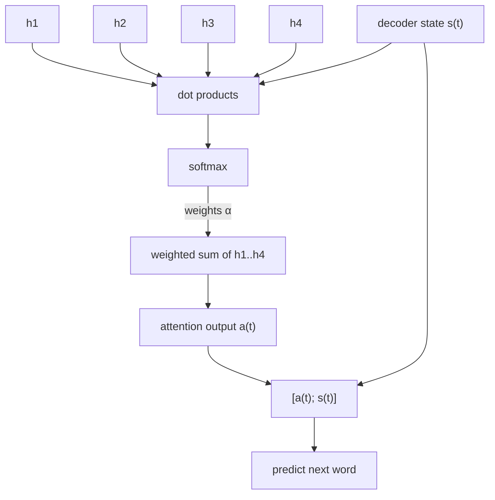

We ended the last lecture with the bottleneck problem: the encoder has to cram a whole sentence into one vector, and the decoder has to make do with that.

Attention is the answer, and it's one of the most important ideas in the whole course.

## The idea

When a human translates a sentence, they don't memorize the whole thing and then write it out. They look back at the source sentence as they go, focusing on the part that matters for the word they're writing right now.

So we do the same. At every decoder step, we let the decoder **look directly at all the encoder hidden states** and choose which ones to focus on.

## How it works

Say the encoder gives us hidden states $h_1, h_2, ..., h_N$. At decoder step $t$, we have the decoder hidden state $s_t$.

**Step 1: Attention scores.** Take the dot product of $s_t$ with every encoder hidden state.

$$
e^t = [s_t^T h_1, \ldots, s_t^T h_N] \in \mathbb{R}^N
$$

(A high dot product means "these two are similar", same intuition as word2vec.)

**Step 2: Attention distribution.** Pass these through a softmax so that they sum to 1.

$$
\alpha^t = \text{softmax}(e^t)
$$

**Step 3: Attention output.** Take the weighted sum of the encoder hidden states, using the attention distribution as weights.

$$
a_t = \sum_{i=1}^{N} \alpha_i^t h_i
$$

**Step 4:** Concatenate $a_t$ with $s_t$ and use that to predict the next word.



So if the decoder is about to produce "pie", the attention distribution will have most of its weight on the encoder state for "entarté". Nice and intuitive.

## Why is this so good?

- **It fixes the bottleneck.** The decoder isn't limited to a single vector any more.
- **Helps with vanishing gradients.** There's now a direct shortcut from the decoder to every encoder state.
- **It's interpretable.** We can plot the attention weights as a grid and see which source words the model was looking at for each target word. It basically learns word alignment *for free*, without anybody telling it to.

```
          il   a    m'   entarté
he        ■    □    □    □
hit       □    □    □    ■
me        □    □    ■    □
with      □    □    □    ■
a         □    □    □    ■
pie       □    □    □    ■
```
(darker = more attention, this is just a toy illustration)

## Attention as a general idea

Here's the more general way to look at it. Attention is:

> Given a set of **values** and a **query**, compute a weighted sum of the values, where the weights depend on the query.

The query "selects" what to take from the values. This is like a soft lookup in a dictionary, where instead of getting one exact match you get a blend of everything, weighted by how well each key matches.

This framing is really important because it's the exact thing the Transformer builds on.

## Other ways to compute the score

Dot product isn't the only option:

- **Basic dot product:** $e_i = s^T h_i$
- **Multiplicative:** $e_i = s^T W h_i$ (learns a matrix in the middle)
- **Additive:** $e_i = v^T \tanh(W_1 h_i + W_2 s)$

The dot product is the simplest and works well. Additive was used in the original attention paper.
