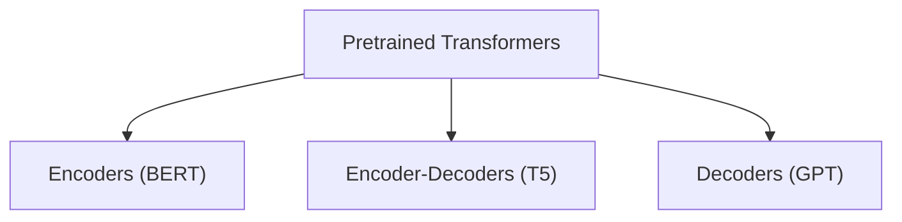

Here's a thing we've been doing so far. Initialize the word vectors with word2vec or GloVe, and then train everything else from scratch. But that leaves the entire rest of the network (the part that figures out syntax, context, and so on) starting from random numbers.

The big idea of this lecture: **why not pretrain the whole network?**

## The pretrain then finetune paradigm

1. **Pretraining:** train a model on a huge pile of raw text, with a task that doesn't need labels. The model has to learn a lot about language to do well.
2. **Finetuning:** take that model and adapt it on your small, labelled dataset.

This works because language modelling forces the model to learn things like grammar, facts about the world, some reasoning, and sentiment, just to predict the next word well.

## Subword models

Before the models, we need to fix an annoying problem. What do we do about words that are not in the vocab? Words like "taaaasty", "Transformerify", or typos?

With a word level vocab, they all become `<UNK>`, and we lose all information.

**Subword tokenization** breaks words into smaller pieces. The most popular method is **Byte-Pair Encoding (BPE)**:

1. Start with a vocab of just individual characters.
2. Find the most frequent pair of adjacent tokens and merge them into a new token.
3. Repeat until you hit the vocab size you want.

So "tasty" is probably a single token, and "taaaasty" might become `ta` + `aaa` + `sty`. Common words stay whole, rare words get broken into pieces, and nothing is ever unknown.

## Three types of pretrained models



### 1. Decoders: GPT

These are just language models. Predict the next word, with masked self-attention so they can't peek.

- Great at **generating** text.
- Only see the left context.
- GPT-1 was pretrained on books, then finetuned on tasks.

### 2. Encoders: BERT

Encoders see both left and right context, so we can't use next word prediction (it would be trivial to cheat). So BERT uses **masked language modelling**:

- Randomly pick 15% of the tokens.
- Replace them with `[MASK]` most of the time (a few get a random word, a few stay unchanged).
- Predict the original word.

*"I went to the [MASK] to buy some milk"* → store.

BERT also had a second task called next-sentence prediction, which later turned out to not matter very much.

- Great for **understanding** tasks: classification, NER, question answering.
- Can't generate text naturally.

### 3. Encoder-Decoders: T5

T5 uses **span corruption**: remove chunks of text, replace each chunk with a special sentinel token, and make the decoder reproduce the missing chunks.

T5 also treated every task as text-to-text, so translation, summarization, and classification were all "put text in, get text out".

## The shift to scale

GPT-2 and GPT-3 showed that if you make decoder-only models bigger and train on more data, they start doing tasks they were never trained for.

### In-context learning

GPT-3 could do a task just by being shown a few examples in the prompt, **with no gradient updates at all**:

```
Translate English to French:
sea otter => loutre de mer
cheese => fromage
hello =>
```

- **Zero-shot:** just describe the task.
- **One-shot / few-shot:** show 1 or a few examples.

### Scaling laws

Loss goes down smoothly and predictably as you increase model size, data and compute. This is why people kept making models bigger. It also gave us the idea of finding the best balance between model size and data for a fixed compute budget (the Chinchilla result said many models were too large for the data they were trained on).

## Why does pretraining help so much?

Honestly, it's a bit mysterious. But a good way to think about it is that predicting the next token on enough text forces the model to compress a lot of knowledge about how the world works into its parameters.
