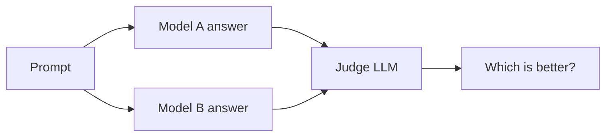

We've built these giant models. Now the question is, how do we know if they're any good? Turns out this is a really hard question, and honestly it's one of the messiest parts of the field right now.

## Why is evaluation hard?

For classification, it's easy. You have a label, the model is right or wrong, you compute accuracy. Done.

For language models, the output is open ended. Ask "Write me a poem about rain" and there is no single right answer. So how do we score it?

## Perplexity

The oldest metric. Perplexity measures how surprised the model is by the actual next words in some held-out text.

$$
\text{PPL} = \exp\left(-\frac{1}{T}\sum_{t=1}^{T} \log P(w_t \mid w_{<t})\right)
$$

Lower is better. A perplexity of 20 means the model is about as confused as if it were choosing between 20 equally likely words at each step.

Good for comparing language models during pretraining. But it doesn't tell you if the model is actually useful, and you can't compare perplexity between models with different tokenizers.

## Benchmarks

The standard approach is to build a fixed test set with right answers and see how many the model gets right.

- **MMLU:** multiple choice questions across 57 subjects (law, medicine, math, history...). Tests knowledge.
- **GSM8K:** grade school math word problems. Tests multi-step reasoning.
- **HumanEval:** write a Python function, and we run unit tests on it. Tests coding.
- **HELM:** not a single benchmark, but a framework that evaluates models on lots of scenarios and lots of metrics (accuracy, calibration, robustness, toxicity...) together.

For multiple choice, evaluation is easy. For things like summarization, people used metrics like ROUGE (n-gram overlap with a reference), but just like BLEU in MT, it misses good answers that are worded differently.

## The problems with benchmarks

### 1. Saturation
Models get 90%+ on a benchmark, and then it can't tell good models from great ones. So we need to keep building harder ones.

### 2. Contamination
The test set might be in the training data. If the model has already seen the questions and answers on the internet, a high score doesn't mean it's smart, it just means it memorized. It's hard to check this since we usually don't know exactly what's in the training data.

### 3. Sensitivity to the prompt
Just changing the format of the question, like the order of the multiple choice options, or whether you write "A)" or "(A)", can change scores by a surprising amount.

### 4. Goodhart's law
> When a measure becomes a target, it ceases to be a good measure.

If everyone is optimizing for the same leaderboard, the models become good at the leaderboard, not necessarily at the real world.

## Human evaluation

The gold standard. Just get humans to look at the outputs.

**Chatbot Arena:** you chat with two anonymous models side by side, and then vote for the better one. Votes are turned into rankings using an Elo-style rating system. It's closer to real usage because users bring their own prompts.

The downsides:
- It's slow and expensive.
- Humans have biases. They like longer answers, confident answers, and nicely formatted answers, even when they're wrong.
- Not reproducible.

## LLM as a judge

A cheaper idea: use a strong LLM to grade the outputs of other models.

It correlates pretty well with human preferences, and it's scalable. But the judge has biases too:

- **Position bias:** prefers whichever answer is shown first.
- **Verbosity bias:** prefers longer answers.
- **Self-preference:** tends to favour answers that look like its own style.

A common fix is to run it twice with the order swapped, and only count it if the judgment is consistent.

## Takeaway

No single number tells you if a model is good. You need to look at a mix: benchmarks, human preference, and (most importantly) testing on your own actual use case.
