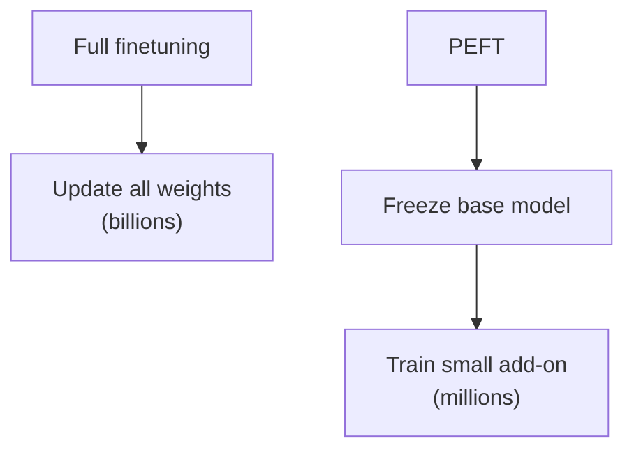

Models now have billions of parameters. This lecture is about a very practical question: how do we actually train and adapt them without needing a data center?

## Why is this a problem?

Take a 7 billion parameter model. Just storing the weights in 16-bit takes about 14 GB. But training needs a lot more than that:

- the weights
- the gradients (same size as the weights)
- the optimizer states (Adam stores 2 extra numbers per parameter)
- the activations

So full finetuning of a 7B model needs many times the memory of just loading it. For anything larger, one GPU is simply not enough.

## Full finetuning vs. its problems

Finetuning every parameter for every new task means:
- huge memory cost
- a full copy of the model for every task you finetune it for (a nightmare to store and serve)
- risk of **catastrophic forgetting**, where the model gets worse at what it knew before

## Parameter-Efficient Finetuning (PEFT)

The idea: **freeze the pretrained model, and only train a tiny number of extra parameters.**



### Adapters
Insert small bottleneck layers (down-project, non-linearity, up-project) inside each Transformer block, and train only those. Works, but adds a bit of latency at inference.

### Prefix / prompt tuning
Add some learnable "virtual token" vectors at the start of the input (or at every layer) and only train those. Super cheap, but tends to work worse on smaller models.

### LoRA (Low-Rank Adaptation)

This is the most popular one. The insight is that the *change* to a weight matrix during finetuning has a **low intrinsic rank**. So instead of learning a full update $\Delta W$ of size $d \times d$, we learn it as a product of two skinny matrices:

$$
W' = W + \Delta W = W + BA
$$

where $B \in \mathbb{R}^{d \times r}$, $A \in \mathbb{R}^{r \times d}$, and $r \ll d$ (like 4, 8, or 16).

```
 frozen W (d × d)
        |
x ------+--------------------> (+) --> output
        |                       ^
        +--> A (r × d) --> B (d × r)
              (trainable)
```

Let's see why this is so nice with an example. Say $d = 4096$ and $r = 8$.

- Full update: $4096 \times 4096 \approx 16.8M$ parameters per matrix.
- LoRA: $2 \times 4096 \times 8 \approx 65K$ parameters per matrix.

That's about 250× smaller.

Other nice things:
- $B$ is initialized to zero, so at the start $\Delta W = 0$ and the model behaves exactly like the pretrained model.
- After training you can **merge** $BA$ into $W$, so there's zero extra cost at inference.
- You can keep one base model and swap in tiny LoRA files for different tasks.

## Quantization

Another angle: make each parameter take less memory.

Instead of 16-bit floats, store weights in 8-bit or even 4-bit integers. A 4-bit model takes about a quarter of the memory of the 16-bit one.

**QLoRA** combines the two: keep the base model frozen in 4-bit, and train LoRA adapters on top in higher precision. This is what let people finetune big models on a single consumer GPU.

The cost is a small drop in quality, usually tolerable.

## Mixed precision training

Do most of the math in 16-bit (faster, less memory), but keep a master copy of weights in 32-bit so small updates don't get rounded away to nothing. bfloat16 is popular because it has the same range as 32-bit floats, so it avoids overflow issues.

## Training across many GPUs

When a model doesn't fit on one GPU:

- **Data parallelism:** every GPU holds a full copy of the model, and each gets different data. Gradients are averaged across GPUs.
- **Model / tensor parallelism:** split the model's layers or matrices across GPUs.
- **Sharding (ZeRO / FSDP):** like data parallelism, but the weights, gradients and optimizer states are *split* across GPUs, and gathered only when needed. This saves a ton of memory.

## Takeaway

For most people, the recipe is: take a pretrained model, quantize it, add LoRA, and finetune on your data. You get most of the benefit at a tiny fraction of the cost.
