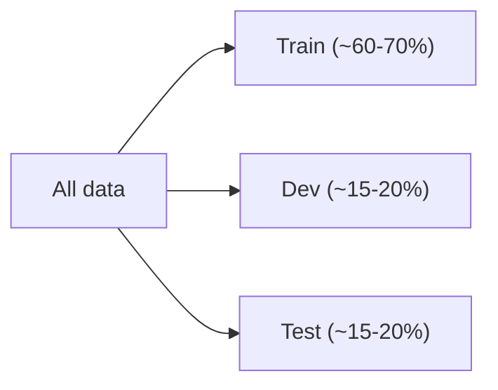

## Bias and Variance

Take housing prices again. You can fit:

1. A straight line: doesn't capture the curve in the data. This is **underfitting**, a **high bias** problem.
2. A quadratic: fits nicely.
3. A degree 5 polynomial that passes through every point: wiggles wildly between the points. This is **overfitting**, a **high variance** problem.

- **Bias:** the model's error from being too simple. Even with infinite data, it can't fit the truth.
- **Variance:** how much the learned model would change if you had a different training set. A high variance model fits the noise in your particular sample.

Another way to see it: with high bias, the algorithm is wrong in a consistent way. With high variance, the algorithm is wrong in an inconsistent way, depending on which data it saw.

```
High bias        Just right       High variance
(underfit)                        (overfit)

 o    o            o   o            o   o
   ___/              _/\_             /\/\
 o/  o            o /    \o         o/    \o
```

## Regularization

How do we avoid overfitting without having to manually restrict the model? Add a penalty on large parameters:

$$
J(\theta) = \frac{1}{2}\sum_{i=1}^{m} \left(h_\theta(x^{(i)}) - y^{(i)}\right)^2 + \frac{\lambda}{2}\|\theta\|^2
$$

- $\lambda = 0$: no regularization, high variance risk.
- $\lambda$ huge: all $\theta \approx 0$, high bias.

From the Bayesian view, this is the same as putting a Gaussian prior on $\theta$ and doing MAP (maximum a posteriori) estimation instead of maximum likelihood.

An $\ell_1$ penalty ($\lambda \|\theta\|_1$) is also popular because it tends to drive many parameters to **exactly zero**, which gives sparse models.

## Train / Dev / Test splits

We can't just evaluate on the training data, since we'd always pick the most overfit model. So split the data:

- **Training set:** fit the parameters
- **Dev (validation) set:** pick between models, tune hyperparameters ($\lambda$, polynomial degree, ...)
- **Test set:** report the final performance, only once, at the very end



If you keep tuning against the test set, you're indirectly overfitting to it, and the number you report will be too optimistic. The test set is for an unbiased estimate, nothing else.

With big data (millions of examples), the dev and test sets can be a much smaller percentage, like 1% each, since that's still tens of thousands of examples.

## Cross-validation

When data is scarce, holding out a big chunk for dev feels wasteful.

**Hold-out cross validation (simple):** split off ~30% as dev, train on the rest, pick the model with the best dev score.

**$k$-fold cross validation:**

1. Split the data into $k$ equal pieces (commonly $k = 10$).
2. For each piece, train on the other $k-1$ pieces and evaluate on it.
3. Average the $k$ scores.
4. Pick the model with the best average. Optionally retrain it on all the data.

It uses the data much more efficiently, but costs $k$ times as much compute.

**Leave-one-out CV:** $k = m$. Train on all but one example, test on that one, repeat $m$ times. Only use this if data is extremely scarce (say $m \approx 20$).

## Feature selection

If you have a huge number of features and suspect only a few matter, one approach is **forward search**: start with no features, and greedily add the one that improves cross-validation the most, repeating until it stops helping. There's also backward search, which starts with all features and removes them one at a time.
