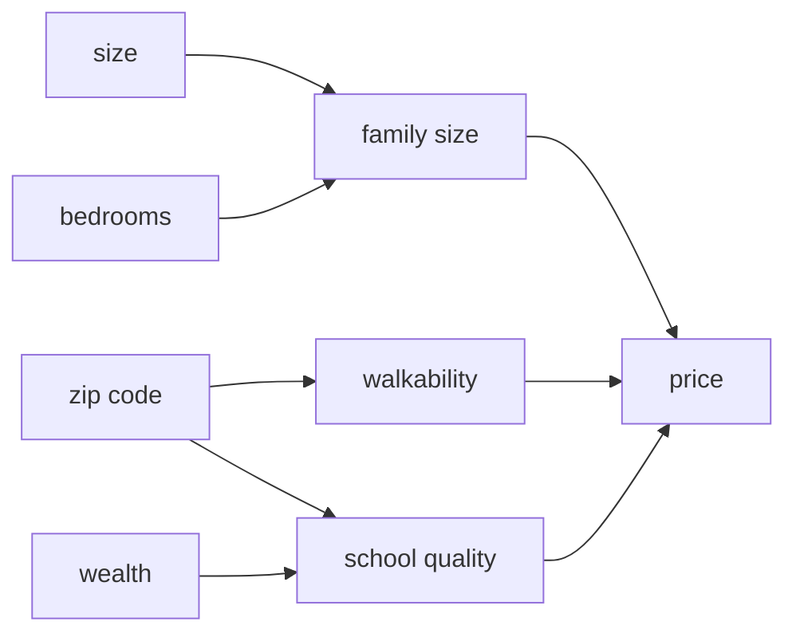

## Starting from logistic regression

Logistic regression is just one neuron:

$$
a = \sigma(w^T x + b)
$$

A neural network stacks many of those. Each neuron takes some inputs, does a linear function, and then applies an activation function.

## The house price example

Say we want to predict the price of a house from 4 features: size, number of bedrooms, zip code, and wealth of the neighborhood.

We could build neurons whose job is to figure out intermediate things:

- "Family size" (depends on size and bedrooms)
- "Walkability" (depends on zip code)
- "School quality" (depends on zip code and wealth)

Then the final neuron takes these 3 and outputs the price.

But here's the beauty of it. We don't tell the network what those hidden neurons should compute. We just connect **every input to every hidden neuron** and let the training figure out what's useful. The hidden units learn their own features.

## Notation

For a network with layers $[0], [1], [2]$:

$$
z^{[1]} = W^{[1]} x + b^{[1]}, \qquad a^{[1]} = g(z^{[1]})
$$
$$
z^{[2]} = W^{[2]} a^{[1]} + b^{[2]}, \qquad a^{[2]} = \sigma(z^{[2]})
$$

- $W^{[l]}$ has shape (neurons in layer $l$) × (neurons in layer $l-1$)
- $b^{[l]}$ has shape (neurons in layer $l$) × 1

Example: input of 3 features, 4 hidden units, 1 output. $W^{[1]}$ is $4 \times 3$, $b^{[1]}$ is $4 \times 1$, $W^{[2]}$ is $1 \times 4$, $b^{[2]}$ is $1 \times 1$. Total parameters: $12 + 4 + 4 + 1 = 21$.

## Vectorization

Don't loop over neurons or examples. Stack all $m$ examples as columns in a matrix $X$ of shape $(n \times m)$. Then:

$$
Z^{[1]} = W^{[1]}X + b^{[1]}, \quad A^{[1]} = g(Z^{[1]})
$$

and so on. This is one big matrix multiplication per layer, which GPUs are extremely good at. A vectorized implementation can be orders of magnitude faster than for-loops.

## Activation functions

- **Sigmoid:** $\frac{1}{1+e^{-z}}$. Gradients vanish at the extremes.
- **Tanh:** zero-centered, but still saturates.
- **ReLU:** $\max(0, z)$. Cheap, doesn't saturate for positive $z$, and the default for hidden layers.

**Why do we need non-linear activations?** Without them, stacking layers collapses into one linear function: $W^{[2]}(W^{[1]}x) = (W^{[2]}W^{[1]})x$. The non-linearity is what makes the network powerful.

## Output layers and cost

- Binary classification: sigmoid output, cross-entropy loss: $-[y\log\hat{y} + (1-y)\log(1-\hat{y})]$
- Multi-class: softmax output, cross-entropy loss
- Regression: no activation (linear) on the output, squared error loss

The cost is the average of the loss over all examples:

$$
J = \frac{1}{m}\sum_{i=1}^{m} \mathcal{L}(\hat{y}^{(i)}, y^{(i)})
$$

We minimize this with gradient descent, and that needs gradients, which is the next lecture.
