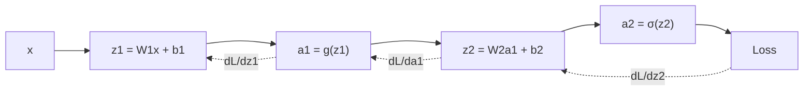

## Backprop

We need $\frac{\partial J}{\partial W^{[l]}}$ and $\frac{\partial J}{\partial b^{[l]}}$ for every layer. Backprop is just the **chain rule** applied cleverly, going from the output backwards, reusing intermediate results.

For a 2-layer network with sigmoid output and cross-entropy loss, working backwards for one example:

$$
\frac{\partial \mathcal{L}}{\partial z^{[2]}} = a^{[2]} - y
$$
(this super clean result is the same as for logistic regression)

$$
\frac{\partial \mathcal{L}}{\partial W^{[2]}} = (a^{[2]} - y)\, a^{[1]T}
$$

Now pass the gradient back to the first layer:

$$
\frac{\partial \mathcal{L}}{\partial a^{[1]}} = W^{[2]T}(a^{[2]} - y)
$$
$$
\frac{\partial \mathcal{L}}{\partial z^{[1]}} = W^{[2]T}(a^{[2]} - y) \circ g'(z^{[1]})
$$
$$
\frac{\partial \mathcal{L}}{\partial W^{[1]}} = \frac{\partial \mathcal{L}}{\partial z^{[1]}} \, x^T
$$

The pattern in each layer: take the gradient coming from above, multiply by the local derivative of the activation, and then the gradient w.r.t. the weights is that times the layer's input.

**Why do we cache the forward pass values?** The backward pass needs $a^{[1]}$, $z^{[1]}$, etc. We've already computed them during the forward pass, so we just store them rather than computing them again.

## Improving neural networks

Having the gradients isn't enough. Here's a list of tricks that make training actually work.

### 1. Activation functions
Sigmoid and tanh squash the gradients when $|z|$ is large (saturation). Gradients become tiny, and learning slows to a crawl. ReLU avoids this for positive values.

### 2. Normalize the inputs
Subtract the mean and divide by the standard deviation of each feature. Otherwise the loss surface is a long narrow valley and gradient descent zig-zags. With normalized inputs, it's more like a round bowl and converges way faster.

### 3. Initialization
Don't initialize weights to zero, because then every neuron in a layer computes the same thing and gets the same gradient. They'd stay identical forever (**symmetry problem**). Initialize randomly.

But also pay attention to the **scale**. For deep networks, the activations can explode or vanish as they pass through layers. Scale the initial weights by $\sqrt{1/n^{[l-1]}}$ (Xavier initialization), or $\sqrt{2/n^{[l-1]}}$ for ReLU (He initialization).

### 4. Mini-batch gradient descent
Using the whole dataset for every step is slow, and one example at a time is noisy and doesn't use the GPU well. In between, use batches of 32 to 512 examples.

### 5. Better optimizers
- **Momentum:** keep a running average of past gradients, so you keep moving in a consistent direction and dampen the oscillations.
- **RMSprop:** divide each parameter's gradient by a running average of its recent magnitude.
- **Adam:** momentum + RMSprop together. A great default.

### 6. Regularization
- $\ell_2$ weight decay (same as before)
- **Dropout:** during training, randomly switch off each neuron with some probability. This stops neurons from relying on specific other neurons, and acts like training an ensemble of many smaller networks.
- Early stopping: stop when the dev error starts rising.

### 7. Gradient checking
Compare your backprop gradient to a numerical estimate:

$$
\frac{J(\theta + \epsilon) - J(\theta - \epsilon)}{2\epsilon}
$$

If they match (up to maybe $10^{-7}$ relative difference), your backprop is probably correct. It's too slow to use in training, so only use it for debugging, and turn it off after.
