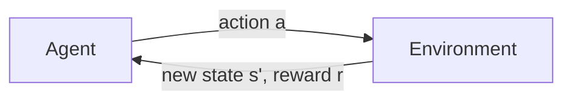

## A bit more on ICA

Quick recap: ICA finds the $W$ that unmixes the signals, assuming independent non-Gaussian sources. The only thing to add is that ICA works well beyond audio, for example in separating brain signals (EEG) from artifacts like eye blinks.

## Reinforcement Learning: the big picture

In supervised learning, we are given the right answer for each input. RL is different: an agent interacts with an environment, takes actions, and gets a **reward** at some points. It must figure out for itself which actions led to good outcomes.

There's a hard part called the **credit assignment problem**. If you lose a chess game after 60 moves, which move was the mistake?

Examples:
- Flying a helicopter (reward for staying stable, big negative for crashing)
- Playing games (win = +1, lose = -1)
- Robot walking

## Markov Decision Processes (MDPs)

An MDP is the standard formal model. It's a tuple $(S, A, \{P_{sa}\}, \gamma, R)$:

- $S$: set of **states**
- $A$: set of **actions**
- $P_{sa}$: **transition probabilities**. $P_{sa}(s')$ is the probability of landing in state $s'$ if you take action $a$ in state $s$.
- $\gamma \in [0, 1)$: **discount factor**
- $R: S \to \mathbb{R}$: the **reward function**

The "Markov" part means the next state depends only on the current state and action, not on the whole history.

### A grid world example

Imagine a $3 \times 4$ grid. The agent starts somewhere, and one square gives +1, another gives -1, and there's a wall. If the agent tries to move North, with probability 0.8 it goes North, and with probability 0.1 each it slips to the left or right. The agent has to find a good plan despite this randomness.

### Discounting

The total payoff from a sequence of states is:

$$
R(s_0) + \gamma R(s_1) + \gamma^2 R(s_2) + \dots
$$

Because $\gamma < 1$, rewards now are worth more than rewards later. It also makes the infinite sum finite. You could also think of $\gamma$ as an "interest rate" or as a probability of the process randomly ending.

## Policies

A **policy** $\pi: S \to A$ tells the agent which action to take in each state.

The goal: find the policy that maximizes the expected total discounted payoff:

$$
E\left[R(s_0) + \gamma R(s_1) + \gamma^2 R(s_2) + \dots \mid \pi\right]
$$

Next lecture: how to actually compute it.
