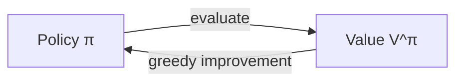

## Value function

For a policy $\pi$, define the **value function**:

$$
V^\pi(s) = E\left[R(s_0) + \gamma R(s_1) + \gamma^2 R(s_2) + \dots \mid s_0 = s, \pi\right]
$$

This is the expected total payoff if you start in state $s$ and follow $\pi$.

### Bellman equation

The value of a state is its immediate reward plus the discounted expected value of the next state:

$$
V^\pi(s) = R(s) + \gamma \sum_{s' \in S} P_{s\pi(s)}(s')\, V^\pi(s')
$$

For a finite number of states, this is a linear system of $|S|$ equations in $|S|$ unknowns, so we can solve it directly.

## Optimal value function

$$
V^*(s) = \max_\pi V^\pi(s)
$$

It satisfies the **Bellman optimality equation**:

$$
V^*(s) = R(s) + \max_{a \in A}\gamma\sum_{s'}P_{sa}(s')V^*(s')
$$

And the optimal policy picks the action that attains that max:

$$
\pi^*(s) = \arg\max_{a \in A} \sum_{s'}P_{sa}(s')V^*(s')
$$

A nice fact: the same $\pi^*$ is optimal **for every starting state**.

## Algorithm 1: Value Iteration

1. Initialize $V(s) = 0$ for all $s$.
2. Repeat until convergence: for every state,
$$
V(s) := R(s) + \max_{a}\gamma\sum_{s'}P_{sa}(s')V(s')
$$

It converges to $V^*$. Then extract $\pi^*$ using the argmax formula.

You can do the update **synchronously** (compute all new values from old values, then replace) or **asynchronously** (update in place, one state at a time). Both converge.

## Algorithm 2: Policy Iteration

1. Initialize $\pi$ randomly.
2. Repeat until convergence:
    - **(a)** Solve for $V = V^\pi$ (using the linear system).
    - **(b)** For each state, update the policy greedily: $\pi(s) := \arg\max_a \sum_{s'}P_{sa}(s')V(s')$

### Which one is better?

- Policy iteration usually converges in fewer iterations, but each one requires solving a linear system, which is expensive for large state spaces.
- Value iteration has cheap iterations, so it's often preferred for large MDPs.
- For small MDPs, policy iteration is often faster.

## Learning the model from data

So far, we assumed we knew $P_{sa}$. In practice, we don't. We estimate it from experience by counting:

$$
P_{sa}(s') = \frac{\#\text{ times we took action } a \text{ in state } s \text{ and got to } s'}{\#\text{ times we took action } a \text{ in state } s}
$$

(If we've never tried $(s,a)$, we say it goes to a uniformly random state.)

The full loop:

1. Take actions using the current policy $\pi$ to collect experience.
2. Update the estimate of $P_{sa}$ (and $R$ if unknown).
3. Solve the MDP (value iteration) with the new model, to get a new $\pi$.
4. Repeat.

### Exploration vs exploitation

If you always follow the current best policy, you might never try some actions that would be better, since you have no data on them. So we need to **explore**. A simple way is **$\epsilon$-greedy**: with probability $1-\epsilon$ take the best known action, and with probability $\epsilon$ take a random one.
