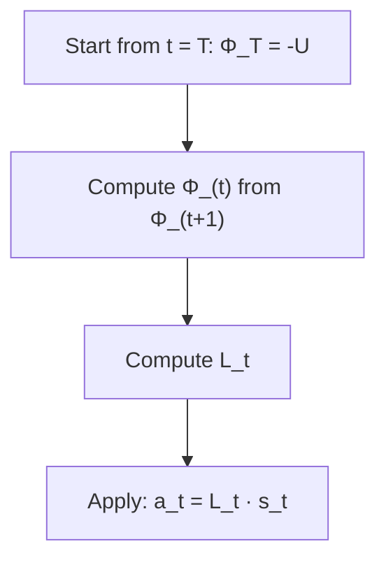

## Designing the reward function

In many problems, the reward function is very hard to specify. Take a self-driving car. What's the reward for "driving well"? A big penalty for crashing, a small one for crossing lane markers, a bonus for smooth driving, reaching the destination fast...? You have to trade off many things, and how you weigh them changes the behavior.

One approach covered here is to learn the reward from demonstrations of a human expert, which is called **inverse reinforcement learning**. We'll stick to the case where reward is given.

## Linear Dynamical Systems and LQR

There's a special class of problems for which the optimal policy has a closed form: **Linear Quadratic Regulation (LQR)**.

**Linear dynamics:**
$$
s_{t+1} = As_t + Ba_t + w_t, \quad w_t \sim \mathcal{N}(0, \Sigma_w)
$$

**Quadratic reward:**
$$
R(s, a) = -\left(s^TUs + a^TWa\right)
$$

where $U$ and $W$ are positive semi-definite matrices. The reward is largest (zero) when $s = 0$ and $a = 0$. So the goal is to keep the system near zero (like keeping a helicopter hovering at a point) using as little control effort as possible.

### Finite horizon LQR

The problem is over $T$ time steps. We solve it by **dynamic programming**, working backwards from time $T$.

At the last step, the value function is quadratic: $V_T^*(s) = s^T\Phi_Ts + \Psi_T$, where $\Phi_T = -U$ and $\Psi_T = 0$.

Then going backwards for $t = T-1, ..., 0$, the value function stays quadratic: $V_t^*(s) = s^T\Phi_ts + \Psi_t$, with:

$$
\Phi_t = A^T\left(\Phi_{t+1} - \Phi_{t+1}B(B^T\Phi_{t+1}B - W)^{-1}B^T\Phi_{t+1}\right)A - U
$$
$$
\Psi_t = -\text{tr}(\Sigma_w\Phi_{t+1}) + \Psi_{t+1}
$$

(The $\Phi$ recursion is called the **discrete Riccati equation**.)

### The optimal policy

It's a **linear** function of the state:

$$
a_t = L_ts_t, \quad L_t = \left(W - B^T\Phi_{t+1}B\right)^{-1}B^T\Phi_{t+1}A
$$

Two beautiful facts:

1. The policy depends on $\Phi$ but **not on $\Psi$**, and $\Psi$ is the only thing that depends on the noise $\Sigma_w$. So the optimal policy is the same regardless of the noise. You can ignore it when computing $L_t$.
2. All of this is computed in closed form, with just matrix operations.

## What if the problem is not linear?

Most real problems aren't linear and quadratic. But we can often **approximate** them as such.

### Linearizing around a point

Take a non-linear model $s_{t+1} = f(s_t, a_t)$. Around some operating point $(\bar{s}, \bar{a})$, use the first order Taylor expansion:

$$
s_{t+1} \approx f(\bar{s},\bar{a}) + \nabla_sf(\bar{s},\bar{a})(s_t - \bar{s}) + \nabla_af(\bar{s},\bar{a})(a_t - \bar{a})
$$

This is linear in $s_t$ and $a_t$. So we can run LQR on it. It works well if the system stays near the operating point, like a helicopter hovering.

### Differential Dynamic Programming (DDP)

For tasks where the system moves along a **trajectory** (e.g., a car following a path), do this:

1. Come up with a rough trajectory using some initial controller.
2. Linearize the dynamics (and quadratize the reward) around the trajectory at each time step.
3. Run LQR (which now gives time-varying $A_t$, $B_t$) to compute a better controller.
4. Simulate the new controller to get a new trajectory.
5. Repeat until it converges.

This is a very practical method for control problems like helicopter flight.
