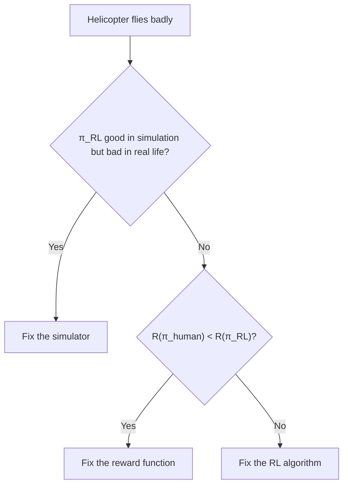

## Policy search

All of the methods so far estimated a value function and derived the policy from it. **Policy search** directly searches for a good policy within a class of parameterized policies $\pi_\theta$.

Why? Sometimes the policy is much simpler than the value function. For example, "turn the steering wheel proportional to the lane offset" is simple, though the value function behind it might be complicated.

### Stochastic policies

Let $\pi_\theta(s, a)$ be the probability of taking action $a$ in state $s$. This is smooth in $\theta$, so we can use gradients.

### REINFORCE

The goal is to maximize $\eta(\theta) = E[R(s_0, a_0) + \dots + R(s_T, a_T)]$.

The result of the **likelihood ratio** trick: the gradient is

$$
\nabla_\theta\eta(\theta) = E\left[\left(\sum_{t=0}^{T}\nabla_\theta\log\pi_\theta(s_t, a_t)\right)\left(\sum_{t=0}^{T}R(s_t,a_t)\right)\right]
$$

We can't compute this expectation exactly, but we can estimate it by running the current policy a few times, and updating:

$$
\theta := \theta + \alpha\left(\sum_{t=0}^{T}\nabla_\theta\log\pi_\theta(s_t,a_t)\right)\left(\sum_{t=0}^{T}R(s_t,a_t)\right)
$$

In words: if a trajectory got high total reward, increase the probability of all the actions taken in it. If it got low reward, decrease them.

It's simple, but the gradient estimates are **very noisy** (high variance), so it needs lots of samples.

## Partially Observable MDPs (POMDPs)

What if the agent can't see the full state, only noisy observations? (A robot only sees what its camera sees.) That's a POMDP.

The agent has to maintain a **belief state**, which is a probability distribution over the true state, updated as new observations come in. The policy then maps beliefs to actions. Exact solutions are intractable for big problems, so we typically use approximate methods, including policy search.

## Pegasus

Policy search needs lots of simulations, and since simulations are random, the estimate of the policy's value is noisy. This makes comparing two policies hard.

**Pegasus** fixes this by using the **same random numbers** for every policy evaluation. Convert the stochastic simulator into a deterministic one by fixing the random seeds up front. Now you can compare two policies fairly, using the same "random" scenarios, and you can run standard optimization on a deterministic function.

## Debugging RL: diagnostics

Say you're making a helicopter fly with RL, and it's crashing. Where do you look? The system has three parts: the **simulator**, the **reward function**, and the **RL algorithm**. Any of them could be the problem.

Suppose we have a human pilot who flies the helicopter well. Run these two checks:

**Check 1: Is the simulator good enough?**
Compare how well the learned policy $\pi_{RL}$ does in the **simulator** vs on the **real helicopter**.
- If $\pi_{RL}$ flies well in simulation but badly in real life, **the simulator is the problem.** Improve the model.

**Check 2: Is the reward function right?**
If the simulator is fine, compare the reward of the human's policy against the RL policy, both measured with your reward function $R$.
- If the human's policy $\pi_{human}$ gets a **lower** reward than $\pi_{RL}$ (even though the human flies better), then the reward function is wrong. The RL algorithm found a policy that is great at maximizing $R$, but $R$ doesn't capture what you want. **Fix the reward function.**

**Check 3: Is the RL algorithm doing its job?**
- If $\pi_{human}$ gets a **higher** reward than $\pi_{RL}$, then the RL algorithm failed to find the best policy under $R$. **Fix the RL algorithm** (more iterations, better optimization, bigger policy class).

## Wrapping up the course

Andrew closes with a few thoughts:

- You now have a large toolbox: supervised learning, learning theory, unsupervised learning, and RL.
- The tools matter, but knowing **when** and **how** to use them matters more. A lot of the difference between people who make ML work and those who don't comes down to debugging and diagnostics, which is what several lectures were about.
- Machine learning is going to be a huge part of the future, so go use it to do something meaningful.
